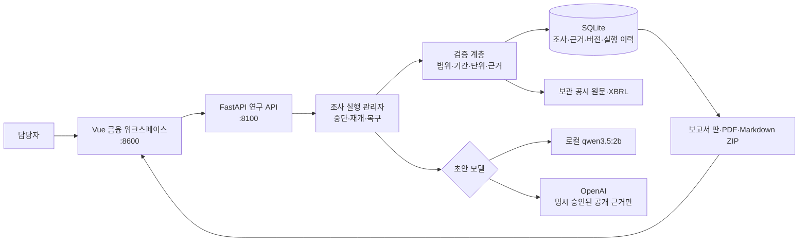
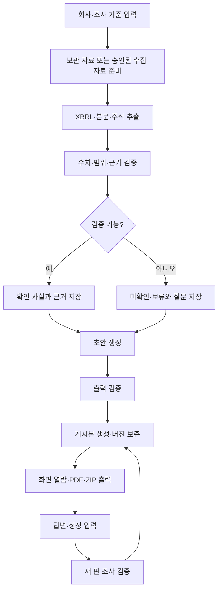
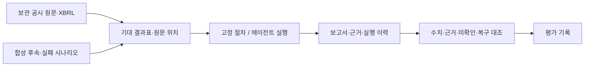
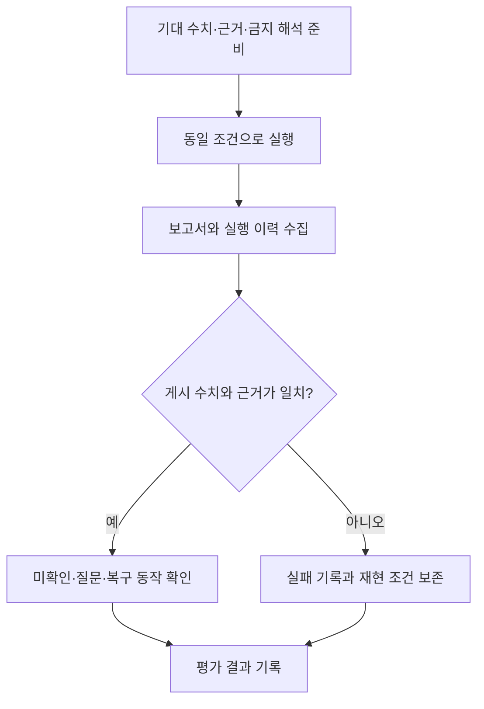
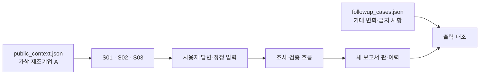
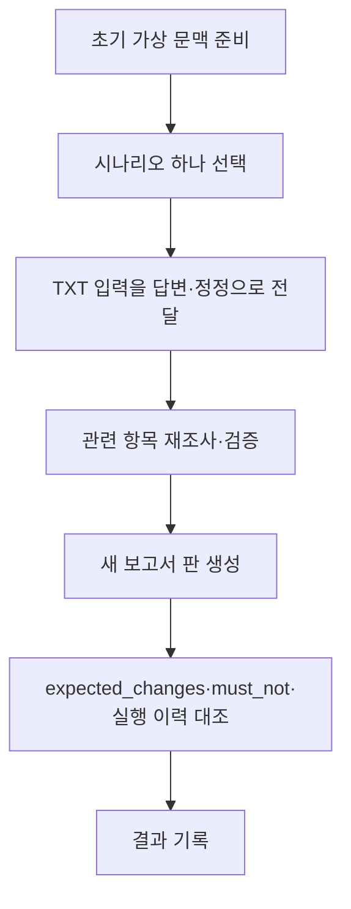

# 기업 운전자금 대출 사전조사 에이전트

공개 공시를 근거로 기업 운전자금 대출 사전조사 초안을 만드는 로컬 PoC입니다. 수치·원문 근거·미확인 항목·추가 질문을 분리해 보여 주며, 대출 승인·거절·등급·금리·한도를 자동 결정하지 않습니다.

기본 경로는 일반 기업 조사입니다. 화면에서 OpenDART 법인을 선택하고 공개 기준일을 지정하면 정기공시·재무 API·원문·XBRL을 별도 실행에 보관하고, 수치 검증·변화 가설·저장 공시 재탐색·보고서 버전 생성을 수행합니다. 상신브레이크 보관 사례는 회귀 검증용으로 함께 유지합니다. 확인하지 못한 수치·차입 구성·원인·내부 자료는 보류와 질문으로 남깁니다.

## 빠른 시작

```bash
bash sh/run_research_ollama.sh
```

위 실행 전 별도 터미널에서 `ollama serve`를 실행하고, 한 번만 `ollama pull qwen3.5:2b`로 모델을 준비합니다. OpenDART 수집에는 Git에 저장하지 않는 `OPENDART_API_KEY` 환경 변수가 필요합니다.

다른 터미널에서 화면을 실행합니다.

```bash
bash sh/run_frontend.sh
```

브라우저에서 `http://127.0.0.1:8600`을 엽니다. 금융 화면은 로컬 Vue·폰트를 사용합니다.

기본 금융 초안은 로컬 `qwen3.5:2b`가 처리하며 외부 모델 호출은 없습니다. 기준일은 화면에서 선택하며, 비교 창은 기준일에 맞춰 최근 3개 연간과 최근 2개 반기로 자동 계산합니다. 공시 목록은 100건 단위의 모든 페이지를 읽되 실행별 외부 호출 예산을 넘지 않습니다.

승인된 공개 공시 근거만 OpenAI 초안 모델에 보내는 실행은 별도 명시 실행입니다. 키는 Git 제외 파일 `.env.openai.local`에만 둡니다.

```bash
bash sh/run_research_openai.sh
```

키만 존재한다고 외부 모델을 자동 사용하지 않습니다. 원문 파일, 사용자 답변, 첨부, DB 경로, 키는 외부 모델에 전송하지 않습니다.

## 아키텍처 구성도



## 워크플로



## 제공 기능

- 회사 입력부터 근거·일곱 항목·초안·게시본까지의 보관 사례 흐름
- 사실, 해석, 미확인, 추가 질문과 원문 위치의 분리
- 답변·정정 후 새 보고서 판 생성 및 이전 판 보존
- 중단·재개·서버 재시작 복구, 실행 예산과 이력 저장
- 보고서 화면, 버전 비교, 한글 PDF와 Markdown·차트·근거 목록 ZIP 출력
- 고정 절차와 에이전트의 보관 사례·합성 실패 평가

## 설계와 평가

### 설계 범위

- 개인 PC의 사용자 1명과 공개 공시를 확보할 수 있는 상장 제조기업
- 기업 식별, 사업·매출 구조, 재무상태·수익성, 현금흐름·운전자본, 차입·유동성, 공시 부담·신뢰성, 대출 목적·상환재원의 일곱 항목
- 확인 사실·해석·미확인·추가 질문을 분리한 보고서와 근거 추적

상세 설계는 [결정 기록](doc/finance/design/DECISIONS.md), [기능 명세](doc/finance/design/FUNCTIONAL_SPEC.md), [조사 흐름](doc/finance/design/RESEARCH_WORKFLOW.md), [데이터·근거 설계](doc/finance/design/DATA_AND_EVIDENCE.md), [API 설계](doc/finance/design/ARCHITECTURE_AND_API.md), [검증 기준](doc/finance/design/VALIDATION_AND_EVALUATION.md)에 보존합니다.

### 평가 구성도



### 평가 워크플로



평가 기준은 [기대 결과표](doc/finance/evaluation/EXPECTED_RESULTS.md), [비교용 JSON](doc/finance/evaluation/expected_results.json), [원문 확인 기록](doc/finance/evaluation/REFERENCE_VERIFICATION.json), [원문 해시 목록](doc/finance/evaluation/source_manifest.json)에 있습니다. 고정 절차와 에이전트는 같은 자료·모델·예산으로 각각 3회 비교하며, 정당한 보류와 공개 항목 누락을 분리합니다.

### 합성 후속 입력 평가





합성 자료는 실제 기업 자료가 아닙니다. [S01 회수 일부 확인](doc/finance/evaluation/synthetic/S01_collection.txt), [S02 용도·조건 추가](doc/finance/evaluation/synthetic/S02_loan_purpose.txt), [S03 숫자 충돌](doc/finance/evaluation/synthetic/S03_conflicting_cfo.txt)은 같은 초기 문맥에서 각각 독립 실행합니다.

## 보안과 운영 경계

| 영역 | 현재 적용 | 남은 한계 |
| --- | --- | --- |
| 접근 | 루프백 서버, Host/Origin 검사, 같은 출처 화면 | 로그인·다중 사용자 권한 없음 |
| 모델 | 기본 로컬 모델, 외부 모델은 명시 동의와 원문별 정책 검사 | 외부 모델 출력의 금융 사실 확정 불가 |
| 자료 | 원문 해시·바이트 위치·범위 검증, 첨부 읽기 제한 | 저장 암호화·악성코드 전수 검사 없음 |
| 이력 | SQLite 조사·근거·검증·버전·실행 이력 | 위변조 방지 감사 로그·SIEM 없음 |
| 배포 | 키·DB·실자료를 배포 ZIP에서 제외 | 파일 내용 전체의 비밀 탐지 보장 없음 |

금융 자료가 충분하지 않으면 값을 0으로 바꾸거나 추정하지 않고 보류로 남깁니다. 구현 완료와 금융 자료 확인 완료는 같은 상태가 아닙니다.

## 검증

```bash
.venv/bin/python -m unittest discover -s tests
.venv/bin/python sh/verify_stage04_completion.py
.venv/bin/python sh/verify_openai_stage05.py
```

실제 OpenAI 단계 5 재현은 비용과 전송 정책을 확인한 뒤에만 `--execute`를 붙여 실행합니다. 자세한 구현·시험 기록은 [로컬 PoC 마무리 기록](doc/finance/IMPLEMENTATION_LOCAL_POC_FINAL.md), [진행 기록](doc/finance/IMPLEMENTATION_LOG.md), [최종 인계](doc/finance/SESSION_HANDOFF_FINAL_20261021.md)를 참고하세요.

## 문서 안내

- [설계·평가 안내](#설계와-평가): 확정 요구와 평가 기준
- [결정 기록](doc/finance/design/DECISIONS.md): 사용자 승인 사항
- [OpenDART 준비](doc/finance/DART_SETUP.md): 일반 기업 수집을 위한 키와 제한
- [구현 후 재확인](doc/finance/POST_IMPLEMENTATION_CHECKLIST.md): 시연·배포·확대 전 체크리스트
