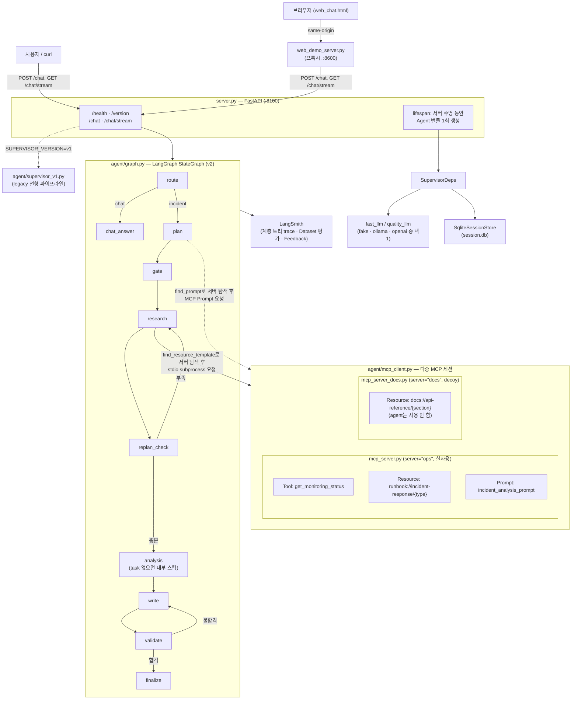
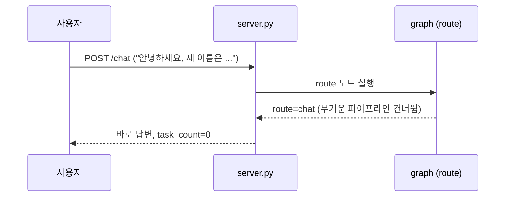
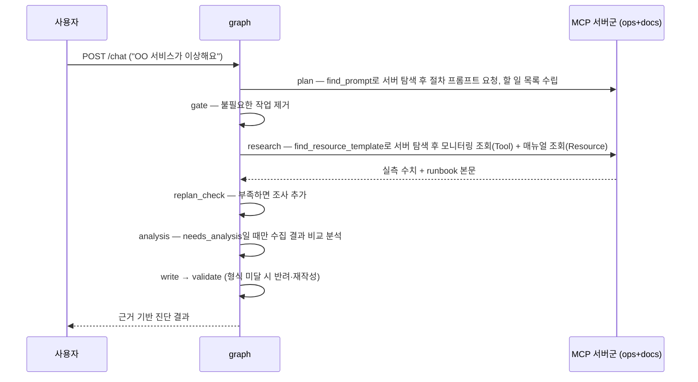
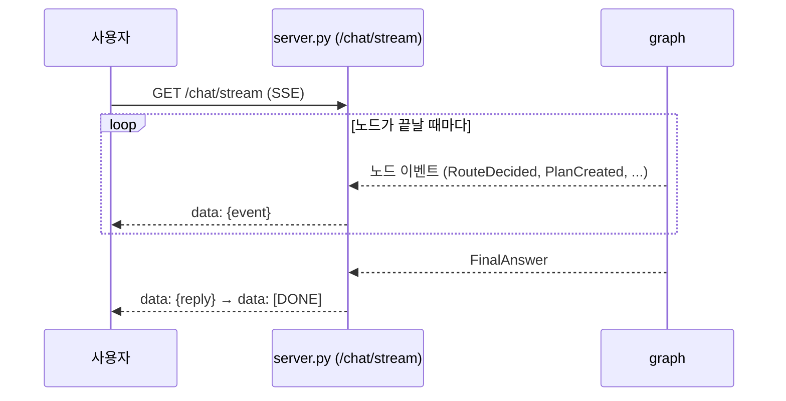
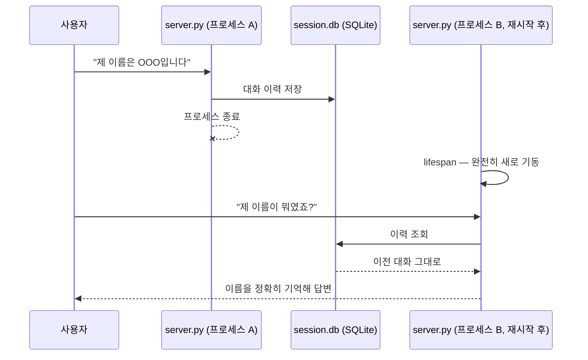
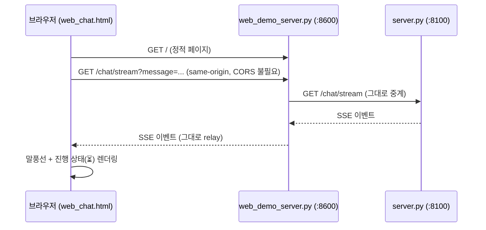

# 기업 운전자금 대출 사전조사 에이전트

공개 공시의 금융 수치와 근거를 연결하고, 사실·해석·미확인·추가 질문을 구분해 담당자의 사전조사를 돕는 로컬 PoC다. 첫 지원 범위는 개인 PC의 사용자 1명과 공시를 확보할 수 있는 상장 제조기업이다. 대출 승인·거절·등급·금리·지원 한도를 자동 결정하지 않는다.

상세 요구와 기존 승인은 [금융 설계 README](doc/finance/design/README.md), [결정 기록](doc/finance/design/DECISIONS.md), [최종 결정](doc/finance/design/FINAL_REVIEW.md)을 따른다. 아래 금융 구현 현황과 이후에 보존한 기존 장애 대응 실습 설명은 적용 범위가 다르다.

## 현재 구현 상태와 재개 조건 — 2026-10-21 확인

**후속 보완:** 사업 내용·첨부 처리·계획 변경/보관함의 구현과 검증은 [로컬 PoC 마무리 기록](doc/finance/IMPLEMENTATION_LOCAL_POC_FINAL.md)을 먼저 확인한다. [중간 커밋 당시 상태](doc/finance/CHECKPOINT_20261021.md)와 아래 이전 검증 기록은 보존한다.

**OpenAI 금융 초안(명시 실행):** 키는 Git 제외 `.env.openai.local`의 `OPENAI_API_KEY=`에만 둔다. 기본 금융 경로는 계속 로컬 `qwen3.5:2b`이며 키 존재만으로 바뀌지 않는다. `bash sh/run_research_openai.sh`에서 비용·전송 범위를 확인하고 승인하면 `gpt-5-mini`(환경 변수 `OPENAI_FINANCE_MODEL`로 변경 가능)를 사용한다. 전송 대상은 이미 검증된 금융 수치 문장과 보류 항목의 ID·설명뿐이며 원문 파일·사용자 답변·첨부·DB 경로·키는 제외한다. 각 원문의 `allow_external_model` 허가가 기본 기준이며, 이번 사용자 승인처럼 보관 공개 공시만 예외로 허용하려면 `FINANCE_ALLOW_ARCHIVED_PUBLIC_EXTERNAL_MODEL=true`를 명시해야 한다. 사용자 답변·첨부·내부 자료는 이 예외 대상이 아니다. 응답은 JSON 스키마와 동일한 근거/보류 출력 검사 뒤에만 게시 후보가 된다. 합성 연결 1회와 공개 공시 근거 초안 2회(첫 응답 길이 초과 거부, 재시도 통과)를 기록했으며, 성공한 실제 초안은 검증 수치 6개·보류 4개·질문 4개를 보존했다. 임시 DB의 5단계 통합 실행도 모델 1회·외부 금융 수집 0회로 게시까지 통과했다. 재현은 `FINANCE_MODEL_BACKEND=openai FINANCE_ALLOW_EXTERNAL_MODEL=true FINANCE_ALLOW_ARCHIVED_PUBLIC_EXTERNAL_MODEL=true .venv/bin/python sh/verify_openai_stage05.py --execute`를 사용한다.

다시 제공된 `927db8d` 시점의 후속 목록은 [최신 작업 대조](doc/finance/NEXT_WORK_STATUS_20261021.md)를 따른다. 4단계 잔여 검증을 완료했고, 사용자 선택에 따라 [5단계 회사 입력부터 첫 초안](doc/finance/IMPLEMENTATION_STAGE05_COMPANY_INPUT.md)까지 상신브레이크 보관 자료로 연결했다. 보관 사례의 초안/후속/복구 구현을 일반 신규 기업 자동 조사 전체의 완료로 해석하지 않는다.

- 4단계의 구현 검증을 완료하고 [5단계 첫 보관 사례](doc/finance/IMPLEMENTATION_STAGE05.md)의 금융 LangGraph·로컬 초안·게시 버전을 연결했다. 사용자 선택에 따라 [6단계 답변·정정 후 새 판 갱신](doc/finance/IMPLEMENTATION_STAGE06.md)을 구현했다. 보관한 상신브레이크 사례 범위이며 일반 신규 기업 자동 조사 전체의 완료는 아니다.
- 전체 회귀·원문 재대조·고장 주입·재시작 조회·원본 보존을 실행한 개발 검증 결과로 구현 완료를 따로 판정한다. 실제 금융 확인 상태와 과거 시험 집계를 혼동하지 않는다. 최종 결과는 [진행 기록](doc/finance/IMPLEMENTATION_LOG.md)에 기록한다.
- 최신 브랜치의 [4단계 인계 문서](doc/finance/SESSION_HANDOFF_STAGE04_20261021.md)를 확인해 XBRL 차입 근거 연결을 보완했다. 같은 공시의 명시적 0은 별도 근거로만 사용하고 본문 대시·빈칸은 보존한다. 원문 재독해 없이 확인 플래그·구성요소 ID만으로 연결을 통과시키지 않는다.
- `stage4_implementation_complete`는 개발 검증 완료, 기존 `stage4_complete`·필수/추가 완료는 금융 자료 확인 상태로 유지한다. `sh/verify_stage04_completion.py`는 전체 시험뿐 아니라 통합 대조·고장 주입·재시작·보존과 현재 소스 지문을 검사한다. 금융 미확인은 다음 단계에서도 보류한다. 5·6단계 진입 시 모델과 보고서 버전 보존·답변/정정 우선 범위를 사용자에게 확인받았다.
- 답변·정정은 별도 미검증 출처로 저장하고 관련 항목을 재검색·재검증한 뒤 새 판을 게시한다. 이전 판·공시 수치는 보존한다. 진행 중 받은 입력은 다음 실행으로 넘기고 같은 기준의 시작 전 입력은 함께 처리한다. 메모는 ‘조사에 반영’한 경우에만 실행하며, 중단은 같은 조사의 대기 작업에도 적용한다. 서버 재시작 후 자동 복구·명시 재개는 아래 7단계 연결을 따른다.
- `GET /case-companies`에서 보관 기업을 검색하고 `POST /researches/start` 한 번으로 새 조사·원문 준비·재검증·로컬 초안·게시를 연결한다. 현재 상신브레이크/공개 기준일2026-10-20만 지원하며 외부 요청은0회다. 기존 DB/검증 플래그를 복사해 완료 처리하지 않는다.
- 사용자 승인에 따라 [7단계 저장형 실행 관리자](doc/finance/IMPLEMENTATION_STAGE07.md)를 서버 내부에 연결했다. 실행 단계·입력·모델 시도·사용량을 SQLite에 저장하고 DB별 프로세스 잠금으로 실행 소유자를 제한한다. 장애로 끊긴 작업은 같은 실행으로 복구하고 명시 중단은 재개 요청 전 유지한다. 보관 사례 범위의 기능이며 일반 기업 수집을 완성한 것은 아니다.
- 사용자10번 선택에 따라 [8단계 금융 화면·출력](doc/finance/IMPLEMENTATION_STAGE08.md)을 연결했다. 로컬 Vue 화면에서 조사 목록·진행·중단/재개·질문/정정/메모·이전 판·변경 비교·수치의 원문 위치를 확인한다. 선택한 게시본을 한글 PDF 또는 Markdown·차트·근거 목록 ZIP으로 내보낸다. 보류 값을 0으로 바꾸지 않으며 금융 확인 미완료를 표시한다.
- 사용자11~13번 승인에 따라 [9단계 보관 사례·합성 실패 평가](doc/finance/IMPLEMENTATION_STAGE09.md)를 진행했다. 고정 절차와 금융 그래프는 같은 최초 조사 코드를 공유하므로 조사 지능의 독립 비교가 아니다. 수치 검사와 본문 공개 내용 충족을 분리하며 시간 절감·누락 감소·질문 유용성 개선은 주장하지 않는다. 평가에서 발견한 게시 직후 감시 경합은 보완했고, 이전 실패와 재평가 결과를 각각 보존한다.

최신 검증은 전체 **292개 시험 통과**다. 사용자14번 선택에 따라 [공개 내용·자료 연결 보완](doc/finance/IMPLEMENTATION_PUBLIC_CONTENT_STAGE09.md)까지 마쳤다. 기존89원문 목록은 보존하고 보관된 후속 보증을 추가한90원문 목록을 새 조사에 적용한다. 현금흐름 조정·환산손익·감사·소송·후속 보증의5묶음13개 원문 행을 범위·당반기 표제·머리글·바이트 위치와 대조해 화면/PDF/ZIP에 연결했다. 인용 확인을 원인 해석·현재 잔액 확인으로 승격하지 않는다.

보완 후 고정 절차/에이전트 각각3회, 총6회가 정상 완료됐다. 매회114개 확인 수치·16개 보류와13개 원문 인용 재조회를 유지했다. 확인 가능한 수치의 오류·누락은 관찰되지 않았다. 사업 구조·전체 최소 확인표의 의미상 충족·질문 유용성·독립 전문가 평가가 남아 **전체 조사 수용은 미입증**이다. 최초 실패와 앞선 비교 묶음도 보존했다. 이번 보완은 로컬 모델6회,9단계 누적18회이며 새 외부 금융/모델/추적 요청0회다. 기존 보호1,357파일 변경/삭제0을 확인했다.

금융 저장 기반 실행:

```bash
bash sh/run_research.sh
```

이 명령은 기존 DB를 삭제하지 않고 로컬 서버를 실행한다. 금융 MCP 연결을 초기화하고, 저장된 승인 작업이나 복구 작업이 있으면 이어간다. 새 조사를 시작만으로 만들지 않으며 명시 중단은 자동 해제하지 않는다. 작업이 없는 저장소에서는 DART·모델을 호출하지 않는다.

다른 터미널에서 `bash sh/run_frontend.sh`를 실행하고 `http://localhost:8600`에 접속한다. 금융 화면의 Vue·한글 폰트는 로컬 고정 파일이며 실행 중 CDN을 요청하지 않는다. 템플릿을 수정한 경우 `node sh/build_finance_ui.cjs`로 사전 컴파일한다. 기존 실습 화면은 `/legacy`에서 보존한다.

현재 회사 입력은 등록된 상신브레이크 보관 자료와 기준일만 지원한다. 배포 ZIP에는 실자료·DB·사례 등록 파일을 넣지 않으므로 배포본에 예시 조사가 자동 포함되지 않는다. 기존 판의 본문과 당시 한계 문구는 수정하지 않고, 현재 기능 상태는 이 README와 구현 기록을 따른다. PDF/ZIP 생성과 게시본 조회는 모델·외부 자료 요청을 발생시키지 않는다.

## 남은 하루의 구현 우선순위

사용자는 **기존 로컬 접근·외부 전송 차단 검증, 금융 도구 허용목록, 배포 파일 제외 보강**을 우선하고, 다중 사용자 권한·저장 암호화·위변조 방지 로그는 한계로 남기는 범위를 승인했다. 기능을 늘리기보다 잘못된 수치·근거·행동을 차단하고 그 결과를 설명할 수 있는 상태를 우선한다.

| 순서 | 직접 수행할 작업 | 완료를 확인할 기준 |
| --- | --- | --- |
| 1 | 4단계 XBRL 근거를 기존 검증 흐름에 연결하고 완료 기준 분리 | 필수 비교 누락·범위 혼합·구성 미확인·가짜 근거를 차단. 구현 완료와 금융 확인 상태를 따로 표시 |
| 2 | 기존 로컬 접근·전송 통제 검증, 금융 도구·입력 허용목록 보강 | 외부 Host/Origin·교차 출처 쓰기, 미허용 도구·추가 인자 거부. 키가 있어도 외부 모델로 자동 대체하지 않음 |
| 3 | 배포 ZIP의 자격증명·실자료 제외 보강 | 합성 비밀 파일·DB·원문·링크가 ZIP에 없고 코드·합성 평가 자료는 포함. 원본·기존 ZIP 보존 |
| 4 | 승인된 로컬 모델·버전 보존·텍스트 답변/정정 연결 | 한 보관 기업의 근거·표·미확인·질문과 후속 새 판 연결. 사용자 답변은 검증 전 사실로 승격하지 않음 |
| 5 | 회귀·공격 입력·재시작 조회 시험과 한계 기록 | 정상/차단 동작, 중복 입력·현재 입력 고정·중단·이전 판 보존을 확인하고 금융 미확인을 구분 |

작업 시간 배분은 약 8~10시간 기준의 추정이다. 최신 파일 확인·4단계 연결에 3시간, 보안 보강에 2시간, 조건 충족 및 선택 확정 후 최소 초안에 2~3시간, 최종 검증·시연 기록에 1~2시간을 잡는다. 최신 코드 확보나 4단계 검증이 지연되면 남은 시간에는 확인된 범위의 시연·한계 기록을 마무리한다. 미확인을 통과로 바꾸어 일정을 맞추지 않는다. 이 배분은 5~9단계 전체 완성이나 성능을 보장하지 않는다.

## 현재 보안 통제와 책임 경계

| 영역 | 현재 코드·이번 보강 | 남은 경계 |
| --- | --- | --- |
| 로컬 접근 | `server.py`와 `web_demo_server.py`의 루프백 바인딩, Host/Origin 검사. 연구 API의 교차 출처 쓰기 거부·응답 캐시 방지 | 로그인·사용자별 인가 없음. 같은 PC에서 접근 가능한 프로세스에 대한 사용자 식별은 제공하지 않음 |
| 도구 권한 | `agent/finance/tool_policy.py`에서 XBRL·택소노미·매핑을 포함한 12개 금융 도구와 입력 형식을 고정. `call_finance`에서 전달 전 검사. 일반 학습용 호출로 금융 도구에 접근하는 경로 거부 | 조사·회사·기준일·예산 검사는 기존 서비스가 추가 수행. OS 권한 격리나 다중 사용자 인가를 구현한 것은 아님 |
| 외부 요청 | DART 고정 API 주소·파라미터 검사, 리다이렉트 거부, 환경 프록시 미사용, 요청 전 사용량 예약·재시도/용량 한도 | XBRL·택소노미를 포함한 허용 도구의 입력 검사를 적용. 공식 기준자료 수집은 인증 이동을 따라가지 않고 선언 URL과 접근 필요 상태만 새 진단에 기록. IR 자동 수집과 OS 방화벽의 외부 통신 차단은 없음 |
| 모델·추적 | 저장된 승인 작업/복구에서 검증한 로컬 `qwen3.5:2b`만 사용하며 금융 그래프 추적은 끔. 새 조사 자동 생성·키에 따른 외부 모델 대체 없음 | 작은 모델의 근거·질문 누락은 실제 발생해 검증·수정/보류로 처리. 합성 공격 시험을 포괄적 방어 인증으로 보지 않음 |
| 원문·파일 | DART ZIP 경로·유형·크기·CRC 검사, XML 엔티티 제한, 원문 해시/바이트 위치 대조. 첨부는 별도 프로세스의 자원/시간 한도로 제한해 읽고 해시·읽기 한계·금융 미검증을 보존. 수식/외부 링크 미실행. 원문은 다운로드로 제공 | 악성코드 전수 검사·OS 수준 네트워크 격리·OCR·암호 해제는 없음 |
| 키·저장 | 인증 필드/URL·알려진 환경 비밀값 저장 거부, DART 인증 URL 로그 비노출, `.env` Git 제외 | 자유 텍스트 전체의 개인정보·비밀 탐지를 보장하는 DLP는 없음. SQLite·원문은 앱에서 암호화하지 않음 |
| 배포 | `sh/package_student.py`가 루트 `.env.example`만 허용하고 `.env.*`, DB/보조 파일, 키 파일, 실자료 경로, 자격증명 디렉터리·심볼릭 링크 제외 | 경로·파일 유형에 따른 제외이며 모든 파일 내용의 비밀 검사는 아님. 공개 문서에 직접 적은 비밀까지 탐지한다고 주장하지 않음 |
| 금융 결과 | 법인·기간·별도/연결·계정·단위·구성·근거를 검사하고 불충분한 계산은 보류. 첫 사례의 게시 수치는 검증 이력에서만 생성하고 모델이 숫자·보류를 바꾸면 거부 | 일반 기업·모든 본문 해석·전체 보고서 정확성·전문가 인증을 의미하지 않음 |
| 이력 | 조사·실행·사용량·검증·근거·버전 이력 저장 | 로컬 DB 수정 권한자에 대한 위변조 방지·외부 감사 보관·보안 관제는 없음 |
| 화면·출력 | 로컬 Vue/폰트·동일 출처 CSP, 사전 컴파일, 고정 API 프록시, 사용자 문구 텍스트 표시. 게시본/근거/원문 해시 재검사 후 출력하고 다운로드 해시도 확인. ZIP은 Markdown·차트·근거 목록으로 제한 | 앱 수준 암호화·문서 DRM·다운로드 후 접근 통제 없음. 근거 발췌는 출력에 포함되므로 자료 이용 조건을 유지하며 원문 전체/일반 첨부는 ZIP에 포함하지 않음 |

금융 MCP의 ‘읽기 중심’은 외부 금융 시스템의 변경 권한을 제공하지 않는다는 뜻이다. 수집·추출·검증 결과와 사용량은 로컬 DB에 저장하므로 DB 자체가 읽기 전용인 것은 아니다. 임의 셸·SQL·URL 실행, 외부 메시지 발송·금융 거래 도구는 허용목록에 없다.

공시·사용자 입력의 명령은 신뢰하지 않는 조사 데이터로 취급하고, 모델 출력은 도구 권한이나 검증 완료 상태를 바꾸지 못하도록 실행 코드에서 검사한다. 합성 공격 자료의 로컬 실모델 시험에서 보류 근거 누락이 실제 발생했고 검증·수정 또는 보류로 처리했다. 이는 프롬프트 인젝션 전반에 대한 방어 인증이 아니다. 입력 문구 차단만으로 완전 방어를 보장할 수 없으며 최소 권한·출력 검사·공격 시험을 함께 적용한다. 참고: [OWASP Prompt Injection](https://genai.owasp.org/llmrisk/llm01-prompt-injection/), [OWASP Excessive Agency](https://genai.owasp.org/llmrisk/llm062025-excessive-agency/).

## 이번 일정의 한계로 남길 사항

- 다중 사용자 로그인·조사 소유자 인가·역할별 승인, 인터넷 공개 운영과 은행 내부 시스템 연동.
- 앱 수준 저장 암호화·키 관리 서버·키 순환, 위변조 방지 감사 로그·SIEM/DLP 연동.
- 고객 개인정보·신용정보·실제 은행 내부자료 처리. 공개 공시와 직접 만든 합성 자료 범위를 유지한다.
- 실모델 인젝션 공격의 종합 평가, 임의 파일의 악성코드 검사·격리 실행, 공급망 취약점의 전수 검증. 잠금 파일 존재를 보안 인증으로 간주하지 않는다.
- 조사별 사용자 삭제·보관기간 자동화, 일반 기업 수집까지의 복구 확대·별도 워커·분산 실행. 현재 보관 사례의 단계 저장·재개·자동 복구·대기·중단은 구현했다. 이전 코드에서 재개 지점을 남기지 않은 실행의 상태/모델 결과를 추정해 복구하지 않는다. 원문 저장 복구와 조사 실행 복구는 구분하며 이번 작업에서는 자료를 삭제하지 않는다.
- 실제 정정공시·다른 기업·비12월 결산까지의 검증 확대, 금융 전문가 검토, 시간 절감·정확도 향상의 일반화.
- 평가에서 발견한 현금흐름 조정·환산손익·감사·소송·후속 보증의 공백은 원문 인용 연결까지 보완했다. 사업 구조·전체 최소 확인표와 원인 설명·질문 의미 품질을 모두 검토한 것은 아니다. 인용·단어 검색·미확인 표시만으로 전체 수용 완료를 선언하지 않는다.

이 항목들은 기존 요구사항을 폐기한 것이 아니라 이번 일정에서 완료를 주장하지 않는 범위다. 개인 PC의 사용자 1명 환경을 벗어나거나 내부자료를 처리하기 전에 추가 설계·구현·검증이 필요하다. NCS 원문·제3자 서식의 배포·변형·모델 적재·외부 전송 제한은 계속 적용한다. 사전조사 초안은 심사 담당자의 판단을 지원하며, 기존 합의대로 에이전트가 수행할 원문 대조를 사용자 필수 승인 단계로 대체하지 않는다.

검증 명령:

```bash
.venv/bin/python -m unittest discover -s tests
.venv/bin/python sh/verify_stage04_completion.py
bash -n sh/make_student_zip.sh
```

시험은 임시 DB·합성 자료를 사용하고 일부는 로컬 테스트 포트와 MCP 자식 프로세스를 사용한다. 실제 DART 수집 명령은 별도이며 자동 시험에 포함하지 않는다. 보안 보강 중 실제 DART·외부 모델·추적 요청을 실행하지 않는다.

배포 ZIP은 `bash sh/make_student_zip.sh [새 ZIP 경로]`로 만든다. 기본 출력은 프로젝트 상위의 `all_total_vue_student.zip`이며 기존 파일이 있으면 실패하고 보존한다. Git 제외와 ZIP 제외는 별도 통제다. `.gitignore`에만 의존하지 않는다.

## 기존 장애 대응 실습 안내

아래는 `APP_MODE=legacy`에서 사용하는 기존 Vue 실습 기반의 설명을 보존한 것이다. 금융 기능 구현 완료나 금융 자료의 외부 전송 동의를 의미하지 않는다.

`all_total`과 백엔드(server.py, agent/, mcp_server.py 등)는 완전히 동일하고, 브라우저
채팅 화면(`web_chat.html`)만 바닐라 JS 대신 **Vue 3**(CDN 글로벌 빌드, 별도 빌드 단계
없음)로 재작성한 버전이다. 나머지 설명은 원본 `all_total`과 같다.

Wave 1~15가 각각 증명한 패턴(싱글턴·MCP·SSE·라우팅·게이트·재계획·검증·재시도·병렬·비용분리·
세션·주입·버전 토글·가드)을 전부 조립한 **실제 동작하는 에이전트 서비스**다. LLM 자리는
`fake`(결정론)/`ollama`(로컬 실모델)/`openai`(실제 API) 세 백엔드 중 아무거나 꽂을 수 있고,
요청 한 건이 처리되는 전 과정은 LangSmith에 계층 트리로 기록·평가·피드백된다.

## 주요 실행 방법

**맨 처음 한 번만**: 이 폴더를 처음 받았다면(학생 배포 등) `.venv`부터 만든다.

```bash
bash sh/setup_venv.sh
```

| 방법 | 명령 | 비용 | 용도 |
|---|---|---|---|
| Python 가상환경 준비 | `bash sh/setup_venv.sh` | 없음 | `.venv` 생성 + `requirements.txt` 설치(최초 1회, 이미 있으면 설치만 재확인) |
| 로컬 Ollama 환경 준비 | `bash sh/setup_ollama.sh` | 없음(로컬 추론) | 모델(`qwen3:0.6b`/`8b`)이 이미 있으면 재사용, 없으면 새로 pull — `OLLAMA_FORCE_REFRESH=1`을 주면 지우고 재구성 |
| 에이전트만 기동 (로컬) | `bash sh/run_agent_ollma.sh` | 없음 | 서버만 띄워두고 직접 curl/웹으로 테스트 |
| 에이전트만 기동 (OpenAI) | `bash sh/run_agent_openai.sh` | **과금** | 위와 동일하되 실제 API 사용 (y/N 확인) |
| 브라우저 채팅 화면 | `bash sh/run_frontend.sh` (서버 기동 후) | 백엔드에 따름 | `http://localhost:8600`에서 실제 채팅 UI로 사용 |

`run_agent_*.sh`/`run_frontend.sh`는 `.venv`가 이미 있다는 가정 하에 PATH에
꽂아 쓰기만 한다(`.venv`가 없으면 시스템 `python3`로 조용히 떨어져 패키지
누락 오류가 날 수 있다) — `setup_venv.sh`를 먼저 돌려야 하는 이유다.

모든 스크립트는 `.env`가 없으면 `cp .env.example .env` 후 본인 API 키를 채우라는 안내를
출력하고 종료하며(외부 경로에 의존하지 않음 — 이 폴더만 떼어가도 그대로 동작),
LangSmith 프로젝트를 백엔드별로 분리해 기록한다(`capstone-all-total[-ollama|-openai]`).

> 기존 장애 대응 실습의 구조와 실행 흐름은 아래 아키텍처·시퀀스 설명을 참고한다.

## 아키텍처 구성도



- **싱글턴**: `server.py`의 `lifespan`에서 `SupervisorDeps`(LLM·세션·MCP 연결)를 정확히
  1회 생성해 `app.state`로 공유한다 — 요청마다 재생성하지 않는다.
- **백엔드 교체**: `LLM_BACKEND` 환경변수 하나로 `fake_llm.py`/`ollama_llm.py`/
  `openai_llm.py`가 바뀌어 꽂히고, 그래프·MCP·세션 코드는 전혀 바뀌지 않는다.
- **버전 토글**: `SUPERVISOR_VERSION=v1`이면 라우팅·게이트·재계획·검증이 없는 legacy
  선형 파이프라인(`supervisor_v1.py`)으로, 재배포 없이 환경변수만으로 전환된다.
- **MCP는 별도 프로세스**: `mcp_server.py`(ops)가 stdio subprocess로 떠서 서버 수명 동안
  재사용되며, 모니터링 조회(Tool)·대응 매뉴얼(Resource)·진단 절차(Prompt) 세 가지
  capability를 모두 실사용한다.
- **MCP 멀티 서버 탐색**: `mcp_client.py`는 `ops`(mcp_server.py, 실사용)·`docs`
  (mcp_server_docs.py, 내부 API 문서 Resource만 제공하는 decoy) 두 서버에 동시
  연결한다. `plan`/`research` 노드는 어느 서버가 필요한 prompt/resource를 들고
  있는지 코드에 하드코딩하지 않고, `find_prompt()`/`find_resource_template()`로
  연결된 서버들을 먼저 조회한 뒤에야 그 서버로 요청을 보낸다.
- **분석 단계 분리**: `replan_check`가 조사 결과가 충분하다고 판단하면 항상
  `analysis` 노드로 넘어가지만, gate가 살려둔 `agent=="analysis"` task가 없으면
  `analysis_node`가 내부적으로 스킵하고 바로 `write`로 넘어간다 — `needs_analysis`가
  실제로 유효한 경우에만 수집된 모니터링 결과들을 비교 분석한다.

## 주요 유스케이스별 고수준 시퀀스 다이어그램

### 1. 가벼운 대화



### 2. 장애 진단 요청



### 3. 실시간 진행 상황 스트리밍



### 4. 서버 재시작 후 대화 기억



### 5. 웹 채팅 화면 사용



## 소스 디렉토리 구조

```
all_total_vue/
├── server.py              # FastAPI 진입점 — lifespan 싱글턴, /health·/version·/chat·/chat/stream
├── mcp_server.py           # fastmcp 서버("ops") — Tool/Resource/Prompt (실사용, stdio subprocess)
├── mcp_server_docs.py       # fastmcp 서버("docs") — API 문서 Resource만 제공하는 decoy (멀티 서버 탐색 데모용)
├── web_chat.html            # 브라우저 채팅 화면 (정적 1파일)
├── web_demo_server.py       # web_chat.html 서빙 + /chat·/chat/stream·/health 프록시(:8600)
├── requirements.txt
├── .env.example
│
├── agent/
│   ├── deps.py              # SupervisorDeps 의존성 주입
│   ├── graph.py              # v2 LangGraph StateGraph (route/plan/gate/research/replan_check/analysis/write/validate/finalize)
│   ├── supervisor_v1.py      # legacy 선형 파이프라인 (버전 토글 대상)
│   ├── fake_llm.py           # LLM_BACKEND=fake — 결정론적 fast/quality 모델 (route/plan/analyze/chat/write)
│   ├── ollama_llm.py         # LLM_BACKEND=ollama — 로컬 실모델 백엔드
│   ├── openai_llm.py         # LLM_BACKEND=openai — 실제 OpenAI API 백엔드
│   ├── mcp_client.py          # MCP 멀티 서버(ops+docs) stdio 클라이언트 — find_resource_template/find_prompt로 서버 탐색 + 의도적 flaky 1회(재시도 데모)
│   ├── retry.py              # Transient 전용 backoff 재시도
│   └── session_store.py       # SQLite 세션 저장소
│
├── data/
│   ├── monitoring.json        # MCP Tool이 조회하는 모니터링 데이터
│   └── runbooks/               # MCP Resource가 조회하는 대응 매뉴얼 6종
│       ├── db-down.md
│       ├── cpu-spike.md
│       ├── disk-full.md
│       ├── high-latency.md
│       ├── memory-leak.md
│       └── network-timeout.md
│
├── sh/                        # 실행 스크립트 모음 (학생 배포용 — 내부 회귀 테스트 스크립트는 제외)
│   ├── setup_venv.sh            # .venv 생성 + requirements.txt 설치 (맨 처음 1회)
│   ├── setup_ollama.sh          # 로컬 Ollama 모델 준비 — 있으면 재사용, 없으면 pull (리셋은 OLLAMA_FORCE_REFRESH=1)
│   ├── run_agent_ollma.sh       # 에이전트만 기동 — 로컬 실모델
│   ├── run_agent_openai.sh      # 에이전트만 기동 — OpenAI API (과금)
│   ├── run_frontend.sh          # 브라우저 채팅 화면(web_demo_server.py) 기동
│   └── make_student_zip.sh      # .env 제외 + .env.example 포함한 학생 배포용 zip 생성
│
├── doc/                       # 문서
│   ├── README.md                # 이 문서
│   ├── manual_ollma.md          # 사용자 가이드 — 로컬 실모델 기준
│   ├── manual_openai.md         # 사용자 가이드 — OpenAI API 기준
│   ├── regression_test_queries.md  # 시스템명 하드코딩 수정 검증용 회귀 테스트 쿼리 목록
│   ├── image_usecase/           # manual_ollma.md 캡처 이미지
│   └── image_usecase_openai/    # manual_openai.md 캡처 이미지
```
