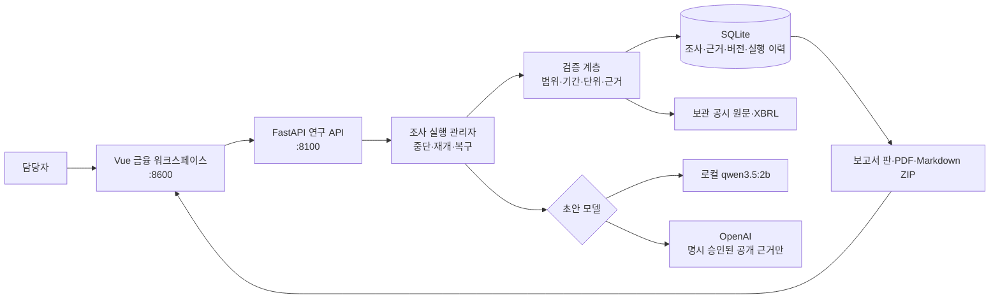
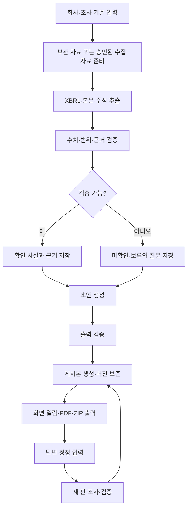

# 기업 운전자금 대출 사전조사 에이전트

공개 공시를 근거로 기업 운전자금 대출 사전조사 초안을 만드는 로컬 PoC입니다. 수치·원문 근거·미확인 항목·추가 질문을 분리해 보여 주며, 대출 승인·거절·등급·금리·한도를 자동 결정하지 않습니다.

현재 검증 대상은 **상신브레이크 보관 사례**입니다. 4단계 XBRL 차입 연결 구현은 완료했고, 해당 사례의 금융 자료 확인 상태는 별도로 남아 있습니다(확인 114건, 보류 16건). 일반 기업의 실제 자동 수집은 OpenDART 키와 대상·기준일·요청 한도를 정한 뒤 검증해야 합니다.

## 빠른 시작

```bash
bash sh/run_research.sh
```

다른 터미널에서 화면을 실행합니다.

```bash
bash sh/run_frontend.sh
```

브라우저에서 `http://127.0.0.1:8600`을 엽니다. 금융 화면은 로컬 Vue·폰트를 사용하며, 기존 실습 화면은 `/legacy`에 남아 있습니다.

승인된 공개 공시 근거만 OpenAI 초안 모델에 보내는 실행은 별도 명시 실행입니다. 키는 Git 제외 파일 `.env.openai.local`에만 둡니다.

```bash
bash sh/run_research_openai.sh
```

키만 존재한다고 외부 모델을 자동 사용하지 않습니다. 원문 파일, 사용자 답변, 첨부, DB 경로, 키는 외부 모델에 전송하지 않습니다.

## 아키텍처 구성도



## 워크플로



## 제공 기능

- 회사 입력부터 근거·일곱 항목·초안·게시본까지의 보관 사례 흐름
- 사실, 해석, 미확인, 추가 질문과 원문 위치의 분리
- 답변·정정 후 새 보고서 판 생성 및 이전 판 보존
- 중단·재개·서버 재시작 복구, 실행 예산과 이력 저장
- 보고서 화면, 버전 비교, 한글 PDF와 Markdown·차트·근거 목록 ZIP 출력
- 고정 절차와 에이전트의 보관 사례·합성 실패 평가

## 보안과 운영 경계

| 영역 | 현재 적용 | 남은 한계 |
| --- | --- | --- |
| 접근 | 루프백 서버, Host/Origin 검사, 같은 출처 화면 | 로그인·다중 사용자 권한 없음 |
| 모델 | 기본 로컬 모델, 외부 모델은 명시 동의와 원문별 정책 검사 | 외부 모델 출력의 금융 사실 확정 불가 |
| 자료 | 원문 해시·바이트 위치·범위 검증, 첨부 읽기 제한 | 저장 암호화·악성코드 전수 검사 없음 |
| 이력 | SQLite 조사·근거·검증·버전·실행 이력 | 위변조 방지 감사 로그·SIEM 없음 |
| 배포 | 키·DB·실자료를 배포 ZIP에서 제외 | 파일 내용 전체의 비밀 탐지 보장 없음 |

금융 자료가 충분하지 않으면 값을 0으로 바꾸거나 추정하지 않고 보류로 남깁니다. 구현 완료와 금융 자료 확인 완료는 같은 상태가 아닙니다.

## 검증

```bash
.venv/bin/python -m unittest discover -s tests
.venv/bin/python sh/verify_stage04_completion.py
.venv/bin/python sh/verify_openai_stage05.py
```

실제 OpenAI 단계 5 재현은 비용과 전송 정책을 확인한 뒤에만 `--execute`를 붙여 실행합니다. 자세한 구현·시험 기록은 [로컬 PoC 마무리 기록](doc/finance/IMPLEMENTATION_LOCAL_POC_FINAL.md), [진행 기록](doc/finance/IMPLEMENTATION_LOG.md), [최종 인계](doc/finance/SESSION_HANDOFF_FINAL_20261021.md)를 참고하세요.

## 문서 안내

- [설계 문서](doc/finance/design/README.md): 확정 요구와 구조 설계
- [평가 자료](doc/finance/evaluation/README.md): 기대 결과와 평가 방식
- [결정 기록](doc/finance/design/DECISIONS.md): 사용자 승인 사항
- [OpenDART 준비](doc/finance/DART_SETUP.md): 일반 기업 수집을 위한 키와 제한
- [구현 후 재확인](doc/finance/POST_IMPLEMENTATION_CHECKLIST.md): 시연·배포·확대 전 체크리스트
