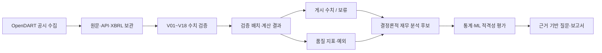

# 금융 분석 기능 준비 상태 감사

> Phase 7 갱신(2026-10-23): Phase 1–6 읽기 모델과 테스트를 구현했다. 실제 다기업 검증 표본 부족이라는 감사 결론은 유지하며 ML 학습은 `not_trained_insufficient_data`로 차단된다.

감사 기준일: 2026-10-23. 이 문서는 현재 저장소 코드와 로컬 `session.db`의 읽기 전용 집계를 근거로 한다. 합성 테스트 자료와 실제 저장 자료를 구분하며, 이 결과는 신용평가·대출 승인 판단이 아니다.

## 1. 현재 데이터 흐름

현재 A~F는 구현돼 있다. G는 일부 산술·증감 분석만 구현됐고, H의 다기업 통계와 ML은 아직 적격성 조건을 충족하지 않는다.

## 2. 기존 엔진과 검증 상태

| 영역 | 실제 코드·자료구조 | 상태 |
|---|---|---|
| 수치 검증 | `NumericValidationService.validate_run`, V01~V07·V13·V18 필수 검사, `numeric_fact` | 구현됨 |
| 산술·기간 비교 | `_calculations`, V08~V12, `comparison_policy`, `Decimal` | 구현됨. 구성·범위가 미확인인 값은 보류 |
| XBRL 개념 대조 | `XbrlMappingService`, `research_validation_batches` | 구현됨, 개념별 보류 가능 |
| 게시 수치 게이트 | `report_context.numeric_rows` | 필수 검사가 모두 통과한 값만 `verified`; 그 외 `withheld` |
| 품질관리 | `quality_registry.py`, `quality_metrics.py`, `quality_exceptions.py`, v6 검토 이벤트 | 구현됨 |
| 변화 분석·질문 | `change_analysis.py`, `report_context.prepare_context` | 검증된 동일 기간 증감과 저장 공시 검색 범위에서 구현됨 |

필수 통과 규칙은 `validation_acceptance.MANDATORY_CHECKS`: V01, V02, V03, V04, V05, V06, V07, V13, V18이다. 수치 계산과 비교는 `Decimal`을 사용한다. 미검증·결측·차입 구성 미확인 값은 값 0이나 분석 입력으로 대체하지 않는다.

## 3. 실제 저장 자료 가용성

`session.db` 읽기 전용 집계 결과:

| 항목 | 관측 결과 | 해석 |
|---|---:|---|
| 조사 기업 | 2개 | 상신브레이크, SK㈜ |
| 실행 | 4개 | 동일 기업의 이전 실행을 포함 |
| 검증 배치 | 5개 | 수치 검증 3개, XBRL 매핑 2개 |
| 게시 보고서 | 5개 | 각 보고서는 게시 당시 검증 배치에 고정 |
| 검증 레코드 | 1,025개 | `numeric_fact` 통과 620건, XBRL·차입 관련 보류가 존재 |
| SK㈜ 최신 수치 배치 | `pass` 14건, 산술 계산 `pass` 2건·`not_checked` 8건 | 2025 연말·2026 반기 중심의 제한된 검증 범위 |

상신브레이크 보관 사례에는 2021~2026의 연간·반기, 별도(OFS)·연결(CFS) 후보가 저장돼 있다. 그러나 보관 사례는 회귀 검증 성격이 강하며 일반 기업 모집단이나 산업 표본으로 사용하면 안 된다.

현재 일반 기업 수집기는 기준일에 맞춰 최근 완료 연간 3개와 최근 반기 2개를 계획하고, DART 공시 목록 전 페이지·정기 보고서 원문·재무 API·XBRL을 수집한다. `GET /companies`, `POST /researches/general/start`, `POST /runs/{id}/collect` 흐름이 있으므로 **다수 기업을 순차 수집·검증하는 기술적 기반은 있다**. 다만 산업군·표본 기준·수집 성공률을 관리하는 코호트 실행기는 없다.

## 4. 지금 구현 가능한 분석

입력은 같은 게시본의 `financial_rows` 중 `verified`이며, 범위(OFS/CFS)·통화·기간·단위를 섞지 않는다는 전제다.

| 분석 | 필요 계정 | 준비 상태 | 구현 위치 재사용 |
|---|---|---|---|
| 전년/동기 증감액·증감률 | 동일 계정의 두 검증 기간 | 가능, 분모 0·기간 불일치 보류 필요 | `comparison_policy`, V11 계산 |
| 영업현금흐름 대비 영업이익·순이익 관찰 | 영업현금흐름, 영업이익, 당기순이익 | 가능할 때만 | `numeric_rows`, `financial_rows` |
| 현금·차입 3계정의 추세 | 현금, V12 통과 차입 소계 | 가능할 때만 | `charts`, V12 계산 |
| 재고·매출채권의 잔액 변화 | 재고, 매출채권 | 가능할 때만 | `numeric_rows`, V11 |
| 자산·부채·자본 구조 변화 | 자산, 부채, 자본 | 가능할 때만 | V08, V11 |

기존 차트와 변화 분석은 위 일부를 이미 표현한다. 새 분석 계층은 이를 재계산해 검증 상태를 바꾸지 않고, 지표의 분자·분모·입력 fact/validation ID를 별도 보존해야 한다.

## 5. 추가 계정 또는 자료가 있어야 가능한 분석

| 분석 | 부족한 입력·제약 |
|---|---|
| 매출총이익률·EBITDA 마진 | 매출원가, 감가상각비, EBITDA의 원문 근거가 없음 |
| 유동비율·당좌비율·운전자본 | 유동자산·유동부채·당좌자산 분류가 없음 |
| 매출채권 회전일수·재고 회전일수 | 매출원가와 평균 잔액, 동기간 정의가 없음 |
| 이자보상배율 | 이자비용과 일관된 이익 지표가 없음 |
| 차입 만기구조·보증 부담 | 주석 구성·리스·보증의 확인 범위가 부족하면 V12가 보류됨 |
| 현금전환주기 | 매입채무·매출원가·기간 평균 잔액이 없음 |

## 6. 기업 간 통계와 ML 적격성

### 기업 간 비교

현재 실제 기업은 2개이며, 각각의 검증 기간·계정 커버리지가 다르다. DART 응답에는 `induty_code`가 있으나 `Company`·`research_bases`에는 산업 분류와 산업 분류 버전이 저장되지 않는다. 따라서 현재는 산업 동종군 비교, 분위수, z-score, 회귀 기준선의 입력 모집단을 정의할 수 없다.

필요 조건은 다음과 같다.

1. 산업 분류 출처·버전·수집시점을 연구 기준과 함께 저장
2. 동일 산업·동일 범위·동일 회계기간·동일 단위로 검증된 다기업 패널 구축
3. 계정별 결측·보류율과 표본 제외 사유 보존
4. 최소 표본 크기·기간 수·이상치 처리 방식을 지표별로 명시

### 머신러닝 이상 관측치 탐지

현재 `.venv`는 Python 3.14.7이며 `scikit-learn`, `numpy`, `pandas`, `scipy`, `statsmodels`가 설치되어 있지 않다. 더 근본적으로 실제 검증 기업 2개는 비지도 이상치 탐지 학습·평가에 필요한 비교 표본이 아니다.

따라서 ML은 **현재 학습 불가**다. 구현 순서는 모델부터가 아니라 적격성 평가다. 적격성 미달이면 `not_eligible`와 부족 사유를 반환하며 학습·점수·이상치 라벨을 만들지 않아야 한다. 합성 데이터로 파이프라인 시험을 할 수는 있지만, 실제 기업 이상 탐지 성능으로 표현할 수 없다.

## 7. API·화면·테스트 구조

- FastAPI: `agent/research_api.py`; 일반 조사, 검증 배치, 보고서, 품질 API가 분리돼 있다.
- 프록시: `web_demo_server.py`의 명시적 허용 목록 방식이다.
- Vue: `static/finance.js`, `static/finance-template.html`, 생성물 `static/finance-render.js`.
- 저장: SQLite 불변 원문·검증 배치·게시 보고서·품질 검토 이벤트. 게시본은 `validation_batch_id`에 고정된다.
- 테스트: 금융 검증, 일반 기업 수집, 품질, 출력, 보안 회귀가 `tests/`에 있다.

## 8. 권장 개발 순서와 위험

1. **분석 입력 계약**: `verified` 수치만으로 `analytics_input` 읽기 모델을 만들고, 범위·기간·통화·단위·근거 ID를 고정한다. 위험: 보류 값을 암묵적으로 포함하는 것.
2. **결정론적 지표**: 가능한 지표만 `Decimal`로 계산하고 분모 0·입력 부족·기간 불일치를 `not_eligible`로 남긴다. 위험: ratio가 신용위험 점수로 오해되는 것.
3. **지표 품질 연결**: 지표마다 입력 검증 상태·품질 예외·제한사항을 연결한다. 위험: 품질 점수와 재무 건전성을 혼동하는 것.
4. **다기업 코호트 수집**: 산업 분류와 기준일을 고정한 실제 다기업 검증 표본을 축적한다. 위험: 계정 의미·연결 범위·결산월을 섞는 것.
5. **통계 분석**: 표본 요건을 통과한 지표만 산업 내 분포·추세로 제시한다. 위험: 작은 표본의 z-score를 유의미한 이상치로 표현하는 것.
6. **ML 적격성 게이트와 이상 관측치**: 패키지·표본·피처 결측률·재현 가능한 평가가 모두 충족될 때만 수행한다. 위험: 모델 결과를 회계오류·부실·신용위험 확정으로 표현하는 것.
7. **질문·시각화**: 이상 관측은 검증·통계 근거·한계와 함께 후속 확인 질문으로만 변환한다. 위험: 인과나 대출 판단을 자동화하는 것.

## 9. 중단 지점

이 감사에서는 분석·ML 코드, 외부 API 호출, 패키지 설치를 수행하지 않았다. 다음 단계는 위 1번 분석 입력 계약의 상세 설계와 구현이며, 다기업 표본·산업 분류 수집을 시작하기 전에는 대상 코호트와 데이터 제공 범위를 확인해야 한다.
