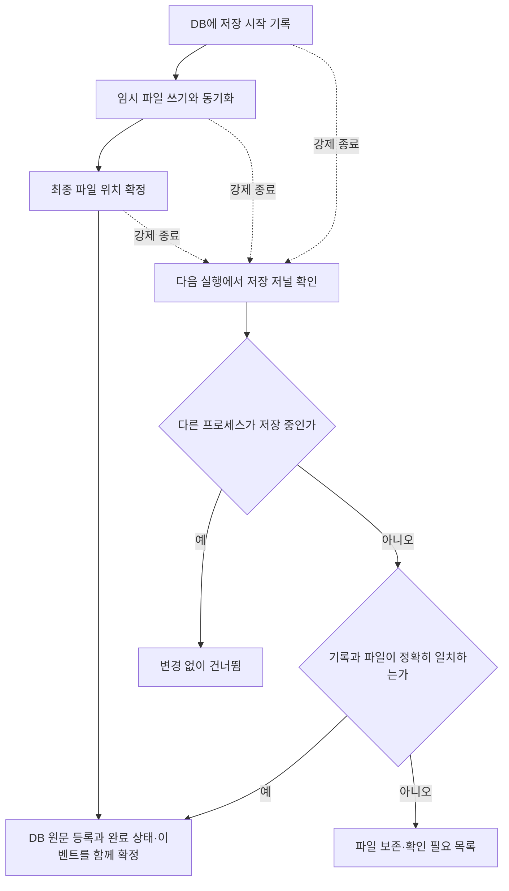

# 0~4단계 보완 기록 — 2026-10-21

사용자가 승인한 실패 판정 강화, 확인 가능한 저장만 자동 마무리, 공식 DART 추가 조회(최대20회), 현재 기업·명시된 표현 중심 지원을 구현했다. Git 작업은 보류하며5~6단계에서 사용자에게 다시 확인한다. 5단계 구현은 이번 작업에 포함하지 않았다.

## 세 기능이 언제 쓰이는가

| 기능 | 사용 시점 | 구현된 동작 |
| --- | --- | --- |
| 실패 판정 | 코드를 바꾼 뒤 실자료 검증 명령을 실행할 때 | 필수 수치 누락·불일치·계산 실패·예상 밖 보류가 있으면 종료 코드1. 결과 파일과 미검증은 보존 |
| 원문 저장 복구 | 공시 저장 도중 프로세스가 종료된 후 다시 실행할 때 | 시작 기록과 파일 크기·해시·경로·출처가 맞는 작업만 저장 완료. 사용 중인 작업과 불명 파일은 건드리지 않음 |
| 지원·실자료 보강 | 다른 표기·단위 또는 빠진 과거 자료를 대조할 때 | 현재 기업의 실제 원문을 추가해 확인하고, 명시된 단위/처리만 지원. 모호한 값은 보류 |

## 실패 판정

`agent/finance/validation_acceptance.py`에 `stage04-acceptance-1.1`을 추가했다. 필수13계정×5기간×2범위의130개 참조가 모두 존재하고 중복이 없는지, 각각의 사실 ID·범위·기간과 필수 검사 결과가 맞는지 검사한다. 핵심 현재 기간의 자산 등식·현금 연결·현금 검산 누락도 막는다. 실패나 예상하지 못한 미검증은 종료 코드1이다. 요약의 pass 개수만 믿지 않는다.

정한 회귀 조건을 통과해도 알려진 자료 부족·차입 주석 구성·연결 범위가 미완료면 `financial_validation_status=incomplete`, `stage4_complete=false`를 함께 기록한다. 종료 코드0은 정한 회귀 범위를 통과했다는 의미이며 금융 검증 전체 완료가 아니다. 이번 추가2024년 반기 문서에 포함된2023년 반기 비교 열의 잔액 부재는 원래 조사 기간 밖의 보조 범위로 명시해 따로 남긴다. 허용 날짜를 명시하지 않은 새 누락은 실패한다.

`sh/validate_numbers.py`의 판정을 결과와 실제 종료 코드에 연결했다. Python 최적화 모드에서 사라지는 assert 대신 명시적 조건 검사를 사용한다. 기존 회귀와 추가 자료 검증 모두 `acceptance.json`을 남긴다.

정상 최종 실행: `data/research/validation_stage04/20261020T235544Z-b530fbc8/` — 종료 코드0, 필수130개 일치, 금융 범위는 미완료.

고장 주입 최종 실행: `data/research/validation_hardening/fault_injection/20261020T235546Z-50623847/` — 종료 코드1. 새 시험 프로세스의 참조 결과 하나만 fail로 바꿨고, 요약의 pass130은 그대로 두었다. 실제 판정이 개별 실패를 잡았다. `python -O`로도 확인했다. 기존 원문·기준 사례를 바꾼 시험이 아니다.

## 원문 저장 복구

`research_schema_v3.sql`로 기존 DB에 `research_source_writes` 저널을 추가했다. 원문 ID·출처·크기·해시·보관 위치·저장소 식별·시작 시각은 불변이고, 상태/사유는 기록하며 변경한다. 대화·조사·기준·원문·검증·보고서 이력은 보존한다. v1/v2 DB는 v3로 추가 마이그레이션한다.



`agent/source_recovery.py`가 프로세스 간 파일 잠금, 임시/최종 파일 fsync, 저장 완료의 DB 트랜잭션, 재시작 복구와 확인 목록을 담당한다. 같은 자료를 중복 등록하거나 이벤트를 중복 발행하지 않는다. 완료된 임시 파일은 검사 후 최종 위치로 확정할 수 있다. 파일 누락·부분 쓰기·해시 차이·다른 저장소 경로·심볼릭 링크는 자동 채택하지 않는다. DB 등록 실패 후 만들어진 파일도 보존하며 다시 확인할 수 있다.

서버와 금융 MCP가 `ResearchStore`를 열 때 자동으로 확인한다. 조회용 `GET /storage/recovery`는 현재 미완료 저널·시작 기록 없는 파일의 상대 위치·시작 시 복구 결과를 반환한다. 이 GET은 복구 작업이나 파일 삭제를 실행하지 않는다.

현재 macOS 환경의 Unix 파일 잠금을 사용한다. Windows 지원 검증은 하지 않았다. [Python fcntl 공식 문서](https://docs.python.org/3.14/library/fcntl.html)

복구 시험8개에 실제 자식 프로세스 SIGKILL을 포함했다. 임시 파일 완료 후, 최종 파일 확정 후 DB 등록 전, DB 등록 완료 후의 종료를 시험했다. 활성 작성자 보호, 손상·누락·불명 파일 보존, DB 등록 실패 이후의 재시도, 저장소 경로/심볼릭 링크 차단도 확인했다. 실제 전원 차단·저장 장치 고장은 시험하지 않았다. 조사 전체를 자동 재개하는7단계 기능과는 별개다.

## 승인된 추가 조회와 실자료 확인

추가 수집: `data/research/validation_hardening/live/20261020T233956Z-db52d0dc/collection.json`

공개 기준일은2026-10-20을 유지했다. 공시 데이터 요청은6회이며,20회 제한 안에서 끝났다. 키·기존 자료·DB를 덮어쓰지 않았고 모델/추적은 호출하지 않았다.

- 전체 공시 이력1회:2023-01-01~2026-10-20, 정정 포함 `last_reprt_at=N`,60건/1페이지.
- 누락 원문 ZIP3회:2023년 사업보고서 `20240315000633`,2024년 사업보고서 `20250314001195`,2024년 반기 `20240813000864`.
- 현금 연결 대조에 필요한2024년 반기 본표 별도·연결2회.

압축 안의 감사 관련 첨부도 원본 그대로 저장했다. 해당 첨부를 주 보고서 본표로 간주해 수치를 자동 승격하지 않는다. 공시검색의 정정 포함 여부와 페이지 계약은 [OpenDART 공식 명세](https://opendart.fss.or.kr/guide/detail.do?apiGrpCd=DS001&apiId=2019001)를 확인했다. 개발 참고용 공식 문서 조회는 위 공시 데이터 요청6회와 별도다.

추가 수집 원본 DB는 보존하고, 읽기 전용 백업으로 만든 분석 DB에서 추출·대조했다. 최종 결과:

`data/research/validation_hardening/live/20261020T233956Z-db52d0dc/analysis/20261020T235335Z-922c2dd7/`

| 검사 | 결과 |
| --- | --- |
| 본표 수치 후보 대조 | 606건 정확 일치. 공시별 반복 기간과 보조 계정 포함 |
| 기존 사례 회귀 | 130개 값 일치 |
| 원래 누락2023/2024 접수 원문 | 확보해 같은 접수 API와 대조 |
| 원래 누락2024년 반기말 현금 연결 | 별도/연결 확인 |
| 대상6개 보고서의 정정 후보 | 수집한 전체60건 목록 안에서 추가 정정 후보 없음 |
| 차입 주석 금액 묶음 | 4개 범위·시점 묶음 통과,26개는 근거 형식·구성 추가 확인 |
| 계산 | 202건 통과,176건 보류. 데이터 범위 확대에 따라 기존103/93과 직접 비교하지 않음 |
| 전체 완료 | false. 차입 구성과 연결 범위 의미 검증은 미완료 |

`disclosure_audit.py`는 같은 회사·시작/종료일·전체 페이지·건수·정정 포함 조건과 원본 해시를 확인한다. 정정 후보나 목록 간 충돌이 있으면 관계를 추정하지 않고 보류한다. 이번 결과는 수집 범위 안의6개 대상 보고서에 대한 확인이다. 정정이 실제 존재하는 다른 기업의 원문 관계 추적을 실자료로 시험한 것은 아니다.

`note_checks.py`는 원문 주석의 명시된 날짜/합계 열·별도/연결 표시·단위·바이트 위치를 확인한다. 장기차입 총액+유동성 대체 차감=비유동 부분 산술이 맞는 경우에만 차감 표시를 본표 유동 잔액과 연결한다. 우연히 같은 숫자가 나오는 은행 개별 열·다른 기간·다른 범위는 사용하지 않는다. 이 검사는 리스/보증까지 포함한 전체 차입 구성 판정을 대체하지 않는다.

## 지원 범위 보강과 원문 위치

추출 버전은 `dart-extraction-1.6`, 수치 규칙은 `numeric-validation-1.8`이다. 억원 단위와 위치가 확인된 명시적 사사오입/절사 문장 변형을 지원한다. 방법이 없는 단위 표시를 반올림 근거로 삼지 않는다. 12월 이외 결산기·다른 기업으로 범위를 확대하지 않았다. 억원/처리 표현의 새 시험은 직접 만든 자료이며, 해당 형식의 다른 기업 실자료 검증으로 소개하지 않는다.

원본 경계가 유일하게 확인되는 복구 표는 원문 바이트로 돌아갈 수 있게 했다. 다만 파싱 내용이 원문과 다르면 `parser_text_matches_raw=false`와 부분 추출 경고를 남기고 수치 후보로 채택하지 않는다. 분석한 주 보고서6개에서 원문 표 경계 미매핑은0개지만, 내용이 달라진 표는33개다. 위치 확인과 내용 복구 성공을 구분한다. 원문 전체 파싱이 정확하다고 표시하지 않는다.

추가 원문에서 새로 읽게 된2023년 반기 비교 열의 현금 연결2건은 원문이 없어 보류했다. 이 값은 기존2025/2026년 반기 조사 범위 밖의 보조 비교 열이다. 미검증을 숨기거나0으로 채우지 않았다.

## 시험·보존·재현

전체 시험105개 통과(기존82개+보완23개). pip check 통과. 합성 규칙·장애 처리 시험, 실제 프로세스 종료/재시작, 공식 자료 수집, 보관 금융 자료 대조를 서로 구분한다. 금융 전문가 정답/조사 효과 평가는 미수행이다.

```sh
.venv/bin/python -m unittest discover -s tests -q
.venv/bin/python sh/validate_numbers.py
.venv/bin/python sh/validate_expanded_cache.py
```

`collect_missing_dart.py`는 실제 외부 요청을 하는 별도 명령이다. 자동 시험에는 넣지 않았다. 이번 승인 범위의 조회는 완료했으며 불필요하게 반복하지 않았다. 분석 명령은 기존 수집 자료를 다시 사용한다.

이전 파일272개의 해시 기준으로 기존 .env·사례·DB·원문 변경/삭제가 없음을 확인했다. 새 검증/분석 DB와 결과는 별도 폴더다. NCS 원문·사례·도표를 시험/검색/모델에 적재하지 않았다. Git 명령·스테이징·커밋·푸시는 실행하지 않았다.

## 남은 부분

- 차입 주석26개 범위·시점 묶음의 날짜/합계 형식·구성 대조와 리스·보증 분리 의미 검증.
- 연결 범위 변경/재작성 의미 검증. 단순 회사 수 동일이나 대시 표기만으로 변경 없음/0을 단정하지 않음.
- 내용이 바뀐 원문 표33개의 추가 복구/확인. 원문 경계만 확인한 상태.
- 실제 정정 공시가 있는 자료의 관계 추적 시험. 후보가 나오면 현재는 보류하며 임의로 관계를 확정하지 않음.

이 항목들은 여전히 미검증으로 보존한다. 모델 연결/초안 게시와 조사 전체 복구는 이후 단계이며, Git은5~6단계에서 사용자에게 다시 질문한다.
