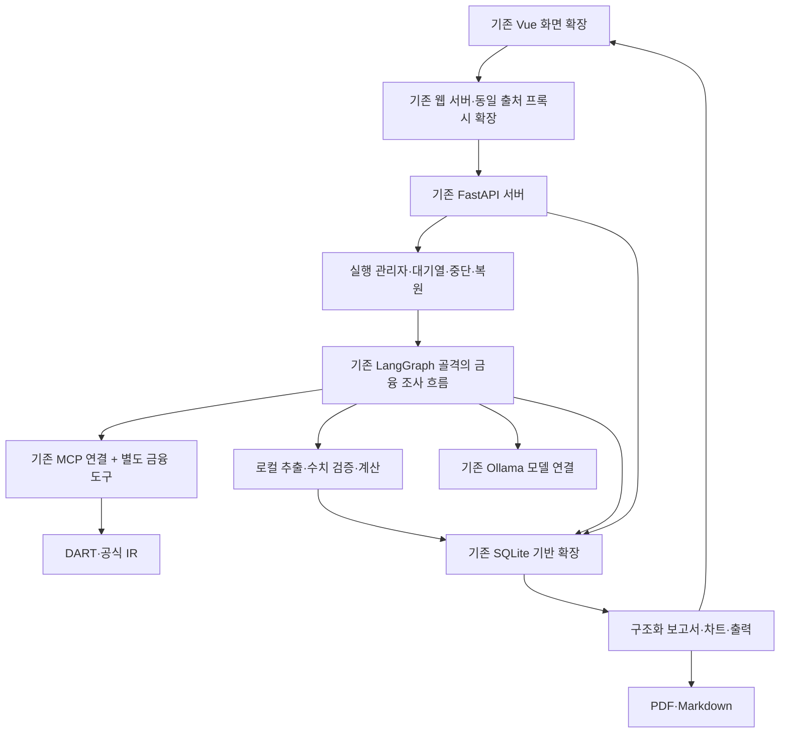

# 기존 코드 재사용 구조·도구·API 계약

버전 1.0. 코드·DDL·실제 엔드포인트는 아직 구현하지 않았다. 경로·모듈명은 구체적인 구현 인계를 위한 설계안이며 사용자가 선택할 동작은 [결정 기록](DECISIONS.md)을 따른다.

## 1. 구성

한 번에 실행 1개, 나머지 대기다. 브라우저 이벤트 구독은 실행의 소유자가 아니다. 실행 관리자와 저장 상태가 조사 수명을 관리한다. 별도 분산 큐·벡터 DB·새 프런트엔드 프레임워크를 첫 구조의 전제로 추가하지 않는다.

## 2. 기존 파일별 활용

| 기존 파일 | 유지할 기반 | 수정·확장 요구 |
| --- | --- | --- |
| `server.py` | FastAPI·lifespan·모델/도구 조립·상태 조회 | 조사 생성/실행/답변/출력 API와 실행 관리자 연결. 원시 프롬프트 노출 제거 |
| `web_chat.html` | Vue·상태 반영·진행 이벤트 | 보고서·근거 중심 화면, 질문·이력, 재접속·중복 이벤트 처리 |
| `web_demo_server.py` | 동일 출처 프록시 | 새 API와 이벤트 중계. 1인 로컬 범위에 맞게 바인딩·출처 검사 |
| `agent/graph.py` | 노드·분기·상태 전달·진행 이벤트 | 장애용 계획/분류·충분성·형식 검증을 금융 정책으로 교체 |
| `agent/deps.py` | 의존성 주입 | 조사 저장소·예산·검증·출력 서비스를 명시적으로 연결 |
| `agent/mcp_client.py` | stdio 세션·도구 호출·서버 설정 주입 | 금융 도구 서버 등록, 실습 실패 시뮬레이션 제거, 서버별 필요한 환경값만 전달 |
| `mcp_server.py`, `mcp_server_docs.py` | 기존 학습 자료·MCP 구현 예 | 금융 기능을 별도 모듈/서버로 두고 실습 도구가 금융 런타임에 잘못 호출되지 않게 함 |
| `agent/ollama_llm.py` | 로컬 호출·스트리밍 | 조사 역할별 구조 출력·타임아웃·취소·응답 검증. 기존 장애 프롬프트 교체 |
| `agent/openai_llm.py` | 향후 선택 가능한 호출 연결 | 외부 전송 설정이 켜진 경우에만 사용. 자동 장애 대체 호출 금지 |
| `agent/session_store.py` | SQLite 파일·대화 기록 | 조사·버전·근거·이벤트·작업 상태. 기존 대화 테이블 보존·마이그레이션 |
| `agent/retry.py` | 재시도 패턴 | 실제 오류 분류·예산·제공처 대기 조건. 인증/부재를 무한 재시도하지 않음 |
| `agent/fake_llm.py` | 결정론적 실행 검증 | 금융 시나리오용 가짜 도구·모델 결과. 실자료 정확성 평가와 구분 |
| `sh/` | 로컬 실행 절차 | DB 삭제·무관 프로세스 강제 종료·원시 환경값 출력 제거 |

새 모듈의 책임 제안: 금융 도구, 원문 추출, 정규화, 검증/계산, 조사 저장소, 실행 관리자, 보고서/차트 출력이다. 실제 파일 개수·함수 구현은 같은 책임과 계약을 지키는 범위에서 이후 정한다.

## 3. 저장·실행 지속성

현재 `graph.compile()`에는 영속 체크포인터가 설정되어 있지 않고 SQLite에는 대화만 저장한다. 현재 구조만으로 서버 재시작 후 노드 상태가 복구된다고 주장하면 안 된다.

조사 DB에 기준·작업·결과·이벤트를 저장하고, LangGraph의 영속 체크포인트 또는 명시적 단계 스냅샷과 연결하는 구조를 제안한다. 체크포인트만으로 금융 근거 저장을 대체하지 않는다. LangGraph 공식 문서는 체크포인터의 실행 상태와 별도 저장 데이터의 역할을 구분한다. [공식 persistence 문서](https://docs.langchain.com/oss/python/langgraph/persistence)

선택한 SQLite 연결의 동시 접근·트랜잭션·잠금 처리는 구현 검증 대상이다. WAL도 쓰기 동시성 문제를 모두 없애는 옵션으로 취급하지 않는다. 원문 다운로드 중 긴 DB 트랜잭션을 잡지 않고 짧게 상태를 확정하는 안을 제안한다. [SQLite WAL 공식 설명](https://www.sqlite.org/wal.html)

MCP 클라이언트의 현재 전역 잠금은 호출을 직렬화한다. 그래프에서 병렬 작업을 만들었다는 이유만으로 외부 조회가 병렬이라고 보고하지 않는다. 첫 구현의 동시성은 단순하게 두고 측정된 시간과 실제 호출 수를 기록한다.

## 4. 금융 도구 계약

| 도구 역할 제안 | 입력 | 구조화된 출력 | 실행 제한 |
| --- | --- | --- | --- |
| 법인 식별 | 회사명/고유번호/종목코드 | 법인 후보·공식 식별·홈페이지 후보 | 임의 법인 추정 금지 |
| 공시 이력 | 법인·기간·보고서 조건 | 접수번호·보고기간·정정·관련 첨부 | 페이지/재시도도 예산 집계 |
| 재무 본표 | 법인·회계연도·보고 코드·범위 | 원본 응답·계정·기간 필드·접수번호 | 조회 응답이 기준일에 맞는지 별도 검증 |
| 공시 원문·첨부 | 접수/문서 식별 | 원문 해시·파일·형식·접수 정보 | ZIP 경로·크기·내용 검증 |
| 공식 IR 탐색·읽기 | 공식 출처 후보·자료 URL | 공식 경로·발행/조회 시점·원문 참조 | 허용 도메인·리다이렉트·접근 범위 검사 |
| 구간 검색·표 조회 | 원문 버전·절/계정/키워드 | 문단/표·머리글·단위·위치·추출 경고 | 근거 없는 요약만 반환하지 않음 |

모델은 키나 임의 네트워크 실행 권한을 받지 않는다. 허용된 도구 이름·검증된 입력만 요청한다. 도구는 성공/자료 없음/제공처 오류/추출 실패를 구별하고 오류에 키나 인증 주소가 포함되지 않게 한다. OpenDART 기능 존재는 공식 안내와 이전 실조회로 확인했으며, 모든 엔드포인트·오류 코드의 서비스 처리 검증은 구현 과제다. [공식 공시정보 안내](https://opendart.fss.or.kr/guide/main.do?apiGrpCd=DS001)

## 5. HTTP API 제안

| 동작 | 경로 제안 | 요청/응답의 핵심 |
| --- | --- | --- |
| 법인 후보 조회 | `GET /companies?query=...` | 후보·식별 정보·지원 판정. 비밀값 없음 |
| 조사 생성 | `POST /researches` | 회사·목적·기준·파일 참조·중복 방지 키 → 조사/기준/실행 ID·표시 계획 |
| 조사 목록·상태 | `GET /researches`, `GET /researches/{id}` | 현재 실행·마지막 게시본·미해결 질문·기준 |
| 실행 이벤트 | `GET /researches/{id}/events` | 저장된 순서 이벤트 + 현재 구독. 실행을 새로 만들지 않음 |
| 계획 수정 | `PATCH /researches/{id}/plan` | 기대 기준/계획 버전 + 변경 → 새 계획 저장·현재 조사 종료 후 후속 실행에 적용 |
| 조사 중단 | `POST /researches/{id}/stop` | 현재 실행+같은 조사의 대기 후속 작업 중지, 재개 전 자동 실행 금지 |
| 재개 | `POST /researches/{id}/resume` | 재개 가능한 상태·기대 버전·중복 방지 → 새 실행 또는 현재 실행 |
| 파일 수신 | `POST /researches/{id}/files` | 형식·크기 제한, 파일 ID·검사/추출 상태 |
| 답변·정정 요청 | `POST /researches/{id}/inputs` | 질문/쟁점 참조·내용·파일 ID·기대 버전 → 입력·후속 처리 |
| 보고서·버전 | `GET /researches/{id}/reports`, `GET /reports/{version_id}` | 구조화 게시본·근거/계산/차트 참조 |
| 근거 열람 | `GET /evidence/{id}`, `GET /sources/{id}/view` | 허용된 원문·정확한 위치·확인 상태 |
| 내보내기 | `POST /reports/{version_id}/exports` | PDF/Markdown → 생성 작업. 실제 다운로드는 별도 GET |
| 내보내기 다운로드 | `GET /exports/{id}` | 생성 상태와 해당 버전의 파일 |
| 조사 삭제 | `DELETE /researches/{id}` | 실행 정지·관련 자료 삭제 결과 |
| 설정·제공처 상태 | 설정 및 상태 경로 별도 정의 | 키 저장 여부/상태만 반환. 실제 키 반환 금지 |

생성·수정 요청은 본문으로 받는다. 기존 GET `/chat/stream?message=...`에 조사 내용·첨부 설명을 계속 넣지 않는다. GET 이벤트 재접속이 중복 조사를 시작하지 않게 한다. 기존 `/chat`의 유지/학습용 분리는 호환 범위를 구현 전에 기록한다.

실행 중 받은 답변·정정 요청·파일은 현재 입력을 바꾸지 않고 다음 실행으로 자동 대기시킨다. 입력 ID·수신 시각·대기 상태·예정 기준을 반환하고 화면에도 표시한다. 같은 메시지의 파일은 한 입력으로 접수한다. 새 후속 실행에 새 한도와 누적 사용량을 적용한다. 중단 범위는 현재와 같은 조사의 대기 실행까지로 확정했다. 파일 수신은 내부 전송 단계이며 사용자는 첨부 포함 메시지 전송만 한다. 서버는 메시지의 파일 전체 상태·수신 ID를 확인하고 입력을 원자적으로 접수해 자동 실행/대기시킨다. 별도 자료 제출·조사 시작 UI를 만들지 않는다.

질문 답변으로 후속 조사가 시작되는 동작은 기존 합의를 유지한다. 수동 재개와 자동 후속 실행이 중복되지 않게 한다. 서버/브라우저의 요청 취소가 사용자의 조사 중단과 같은 뜻인지 혼동하지 않는다.

## 6. 이벤트 계약

공통 필드 제안: event_id/순번, research_id, basis_version_id, run_id, 발생시점, 종류, 표시 요약, 관련 객체 ID. 원시 프롬프트·키·첨부 전문을 넣지 않는다.

종류 예: 조사 생성, 계획 표시, 작업 시작/결과, 원문 확보, 수치 대조, 충돌 발견, 쟁점 수정, 질문 생성, 초안 작성 중, 검증 결과, 보고서 게시, 중단, 한도 종료, 재개, 출력 완료.

SSE는 저장된 event_id 이후를 재생하고 프런트는 중복 ID를 무시한다. 보관 범위를 벗어난 커서면 현재 스냅샷과 재동기화 사실을 반환한다. 모델의 토큰 스트림은 미검증 미리보기로 구분하고 게시 보고서와 섞지 않는다. 연결 종료가 새로운 실행이나 현재 작업의 손실을 만들면 안 된다.

## 7. 로컬 환경·보안 경계

서버와 프록시는 1인 로컬 범위에 맞춰 루프백 바인딩을 기본 설계로 한다. 기존 프런트 서버의 `0.0.0.0` 바인딩을 그대로 두고 로컬 전용이라고 설명하지 않는다. 허용 origin·호스트와 변경 요청을 검사하고 키 설정·파일·삭제 경로가 외부 페이지에서 호출되지 않게 한다. 세션/요청 보호의 구체 수단은 구현 시 검증한다.

외부 URL은 HTTP(S)·공식 출처와 필요한 CDN 관계를 검증하고 리다이렉트마다 로컬·사설망 접근을 차단한다. 원문에서 발견한 링크나 지시는 실행 지시가 아니다. 업로드의 확장자·내용·경로를 확인하고 매크로·스크립트·외부 참조를 실행하지 않는다. 파일 저장은 서버가 지정한 조사 경로 안에서만 한다.

외부 모델과 추적은 각각 기본 비활성이다. 사용자가 설정한 전송 범위와 자료별 제한을 확인한 후에만 호출한다. 기본 로컬 실패를 외부 호출의 승인으로 간주하지 않는다. 화면·로그·프롬프트에서 비밀값을 가리고 NCS 제한은 전송 설정과 독립적으로 준수한다.
