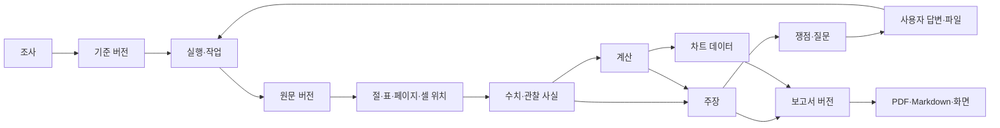

# 데이터·근거·계산·버전 설계

버전 1.0. 아래는 논리 데이터 모델과 무결성 요구다. 실제 DDL·마이그레이션·클래스 코드는 구현 단계에서 작성한다.

## 1. 저장의 기준

기존 SQLite 연결·대화 저장 기반을 확장한다. 대화 기록만으로 조사 상태를 재구성하지 않는다. 조사 기준, 실행, 원문, 수치, 계산, 주장, 질문, 보고서 버전을 별도로 식별한다. 원문·첨부·차트·출력 파일은 로컬 파일에 두고 DB는 참조·해시·버전·연결 관계를 저장하는 구조를 제안한다.

원문 위치가 없는 수치·주장에 출처 번호만 붙여 근거 연결을 완료한 것으로 보지 않는다.

## 2. 논리 엔터티

| 엔터티 | 주요 필드 제안 | 무결성 조건 |
| --- | --- | --- |
| Research | id, 회사 식별, 목적, 생성일, 최신 기준/보고서 참조 | 다른 기업의 자료를 같은 현재 범위로 섞지 않음 |
| BasisVersion | research_id, 공개 기준일, 비교 창, 재무 범위, 목적 버전, 정책 스냅샷 | 실행 중 임의 변경 금지. 변경은 새 버전 |
| Run | basis_id, 이전 실행, 트리거 입력, 상태, 예산/사용량, 저장 지점 | 보고서 게시와 실행 종료 상태 구분 |
| Task | run_id, 쟁점, 도구/인자 지문, 상태, 시도 수, 결과 참조 | 중복·재시도·새 심화 행동을 구분 |
| SourceVersion | 출처 종류, 발행 주체, 접수/파일 버전, 원문 해시, URL, 발행/조회/기준 시점, 저장 참조, 이용·전송 정책 | 키가 포함된 URL 저장 금지. 원문은 불변 |
| Fragment | source_version_id, 절/표/페이지/셀 위치, 텍스트·표 구조, 단위/머리글/주/추출 경고 | 원문으로 다시 찾아갈 수 있어야 함 |
| Fact | 값/관찰, 원문 문자열, 법인·범위·기간·통화·단위·계정, 근거 위치, 변환 기록, 확인 상태 | 후보·지원됨·충돌·사용 불가를 구분 |
| Calculation | 산식 버전, 입력 fact/calc 참조, 정확한 결과, 표시 규칙, 제한 | 산식과 입력을 재현 가능. 순환 참조 금지 |
| Claim | 사실/해석/미확인, 문장, 지지·반대 근거, 적용 시점, 검증 결과 | 해석을 확정 사실로 승격하지 않음 |
| Issue | 기본 항목, 해결할 질문, 발견 근거, 설명 후보, 상태, 영향받는 주장 | 상태 변경 이유·이전 설명 보존 |
| Question | issue_id, 질문·이유, 공개 조사 시도, 필요한 정보, 답변 참조 | 답변 수신과 검증 완료를 구분 |
| UserInput | 설명/답변/파일, 수신 시점, 제공 주체·문서 기준일, 내용 해시, 이용/전송 정책 | ‘사용자 제공’ 표시 유지. 무조건 공식 자료로 취급하지 않음 |
| ValidationResult | 대상, 규칙/버전, pass/fail/not_applicable/not_checked, 근거·오차·설명 | 미실행·해당 없음을 통과로 집계하지 않음 |
| ReportVersion | basis/run, 버전, 게시 상태, 구조화 내용, 참조 manifest, 제한·작성일 | 게시본 불변. 새 근거는 새 버전 |
| Chart | 보고서 버전, fact/calc 참조, 계열·기간·단위·범위, 이미지 참조 | 표시 수치와 본문의 같은 데이터 사용 |
| Export | report_version, 형식, 생성 상태, 파일 해시/경로, 생성일 | 최신이라는 이유로 요청 버전과 다른 파일 반환 금지 |
| Event | research/run, 증가하는 순번, 종류, 발생일, 공개 가능한 payload | 상태 저장과 순서가 일관돼야 재접속 복원 가능 |

`SourceVersion` 등은 논리 이름이다. 실제 테이블을 합치거나 나눌 경우에도 관계·불변성·삭제 요구를 유지해야 한다. 구체적인 저장 구조 변경은 구현 인계 시 사용자와 논의한다.

## 3. 수치 한 건의 계약

| 필드 묶음 | 필요한 정보 |
| --- | --- |
| 무엇 | 원래 계정명·ID·표 계층, 정규화 계정, 매핑 규칙 버전 |
| 누구 | 법인 식별, 별도/연결, 연결 범위 설명 |
| 언제 | 기초/기말 시점 또는 기간 시작·끝, 3개월/누적, 회계연도 |
| 얼마 | 원문 문자열, 정확한 수, 원문 단위·통화, 환산·부호 처리 |
| 어디 | 접수번호/파일 해시, 절·표·행·열·페이지·셀 |
| 어떤 상태 | 후보/근거 대조됨/충돌/사용 불가, 검사 결과 |

금액은 정수 또는 정밀 십진수로 계산한다. 표시용 억원·반올림 값을 계산 입력으로 되돌리지 않는다. 비율·환산을 구현할 때도 산식·기간·분모 의미를 고정하고 원자료를 보존한다.

빈 문자열·미공시·접근 실패·추출 실패는 `null`과 이유로 표현한다. 실제 0은 수치 0과 원문 근거다. 괄호 손실·부호·천원/원·통화가 모호하면 차트·확정 사실에 사용하지 않는다.

## 4. 네 종류의 시점

- 보고 기준시점/기간: 재무 수치가 설명하는 날짜·기간.
- 발행·접수 시점: 그 정보가 공개된 시점. 날짜만 알면 시각까지 아는 것처럼 기록하지 않음.
- 조회·수신 시점: 시스템이 실제로 읽은 시점.
- 조사 공개 기준일: 이번 조사에서 허용할 공개 정보의 경계.

2025년 수치라는 이유로 2026년에 공개된 보고서를 2025년 말 당시 알았던 정보로 쓰면 안 된다. 최신 API 값이 과거 기준일 이후 정정본에 속하면 해당 기준일 원문을 확보하거나 재현 한계를 표시한다.

## 5. 정정·자료 충돌

원문과 수치 버전을 덮어쓰지 않는다. 정정 관계는 이전/대체 버전으로 연결하고 조사 기준일에 허용되는 버전을 선택한다. 적용한 버전과 이전 수치를 함께 추적할 수 있어야 한다.

대조 순서: 법인→별도/연결→기간·시점/누적→단위·통화→계정·구성→잠정/감사 후·정정→반올림이다. 이 확인으로 설명되지 않는 차이는 충돌로 남기고 관련 조회를 추가한다. 공식 공시와 사용자 설명이 다르다는 이유만으로 한쪽 값을 삭제하지 않는다.

차이가 반올림으로 설명되는 경우도 정확히 일치한 결과와 구분한다. 반올림 허용 오차는 원문 표시 정밀도에서 도출해야 하며 임의의 비율로 금융적 중요성을 판단하지 않는다. 구체적인 계산 규칙은 검증 설계와 구현 때 버전으로 고정한다.

## 6. 근거 위치와 검색

합의한 첫 방식은 문서 구조·표·주석·키워드 검색이다. 전체 원문을 모델 입력으로 통째로 보내는 것을 기본으로 삼지 않는다. 각 후보 구간에 법인·범위·보고기간·단위·머리글·주를 함께 전달한다. 검색 결과가 없는 것과 해당 내용이 없는 것을 구분한다.

| 원문 | 위치 표현 |
| --- | --- |
| 공시 XML/HTML | 접수번호·첨부 문서·절 경로·표 번호·행/열·원문 부분 해시 |
| PDF | 파일 해시·물리 페이지·영역·표 행/열, 필요 시 인쇄 쪽수 별도 |
| XLSX | 파일 해시·시트·셀/범위·머리글·수식/저장된 결과·숨김 시트/행/열·필터 상태 구분 |
| CSV/TXT | 파일 해시·행·열/문단·인코딩 |
| 공식 IR 웹 | URL·조회·발행 시점, 콘텐츠 해시·표/문단 |

텍스트를 정리하더라도 원문과의 위치 매핑을 유지한다. 파서 복구 경고를 삭제하지 않는다. 수동 검토 사례에서 쓴 복구 파싱을 서비스 수준으로 검증됐다고 간주하지 않는다. 검색 라이브러리·SQLite FTS 사용 여부는 실제 환경에서 확인할 구현 세부다. 별도 의미 검색 DB는 첫 범위에 넣지 않는다.

## 7. 버전 갱신·캐시·삭제

후속 입력이 들어오면 바뀐 입력을 참조하는 사실·계산·주장을 따라 무효화하고 재검증한다. 영향받지 않은 근거는 재사용할 수 있지만 같은 법인·기준·원문 버전인지 검사한다. 보고서 v1을 지우고 v2로 바꾸지 않는다.

공식 접수번호와 콘텐츠 해시는 원문 캐시 식별에 활용한다. 사용자 파일은 공용 공식 자료 캐시와 분리한다. 조회 이력과 발행 시점을 보존하고, 캐시가 있다는 이유만으로 최신 정정 확인을 생략하지 않는다.

사용자 삭제 전까지 보관한다. 조사 삭제 시 실행을 정지시키고 관련 개인 입력·근거 연결·초안·이벤트·출력을 제거한다. 공유 공식 원문은 다른 조사에서 참조 중이면 보존하되 삭제한 조사의 연결은 복원되지 않아야 한다. 이미 사용자가 외부로 내려받은 파일을 앱이 삭제할 수 있다고 안내하지 않는다. 상세 삭제·백업 정책은 UX와 운영 선택에서 명확히 표시한다.

키는 `.env`에서 서버·금융 도구가 필요한 범위로만 읽는다. 프롬프트·DB·원문 URL·진행 이벤트·에러·내보내기에 포함하지 않는다. NCS 원문·제3자 도표와 권리 미확인 교육 자료는 기업 조사 검색 데이터에 자동 적재하지 않는다.
