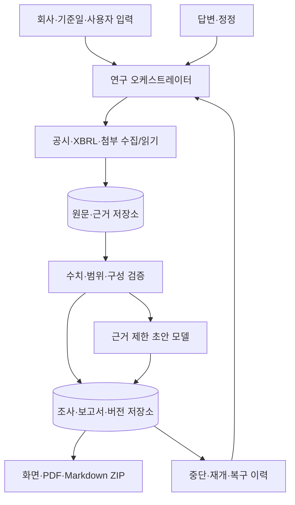
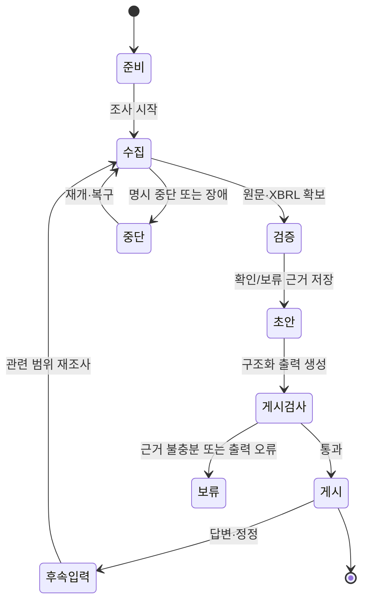

# 금융 사전조사 설계

이 폴더는 기업 운전자금 대출 사전조사 PoC의 요구, 데이터 구조, 실행 정책을 정의합니다. 현재 구현·시험 결과는 루트 [README](../../../README.md)와 [구현 기록](../IMPLEMENTATION_LOG.md)을 기준으로 확인합니다.

## 설계 범위

- 개인 PC의 사용자 1명과 공개 공시를 확보할 수 있는 상장 제조기업
- 기업 식별, 사업·매출 구조, 재무상태·수익성, 현금흐름·운전자본, 차입·유동성, 공시 부담·신뢰성, 대출 목적·상환재원의 일곱 항목
- 확인 사실·해석·미확인·추가 질문을 분리한 보고서와 근거 추적
- 중단·재개·답변·정정·버전 보존과 로컬 출력

대출 승인·거절·등급·금리·한도 결정, 다중 사용자 운영, 은행 내부 시스템 연동은 범위에 포함하지 않습니다.

## 아키텍처 구성도

## 워크플로

## 문서 읽기 순서

| 문서 | 내용 |
| --- | --- |
| [DECISIONS.md](DECISIONS.md) | 사용자 승인과 미결정 항목 |
| [FUNCTIONAL_SPEC.md](FUNCTIONAL_SPEC.md) | 입력·결과·예외 동작 |
| [RESEARCH_WORKFLOW.md](RESEARCH_WORKFLOW.md) | 조사·중단·재개 상태 |
| [DATA_AND_EVIDENCE.md](DATA_AND_EVIDENCE.md) | 수치·근거·버전 데이터 모델 |
| [ARCHITECTURE_AND_API.md](ARCHITECTURE_AND_API.md) | API·도구·구성요소 설계 |
| [RUNTIME_AND_MODEL_POLICY.md](RUNTIME_AND_MODEL_POLICY.md) | 모델·요청·예산 정책 |
| [UX_AND_REPORT.md](UX_AND_REPORT.md) | 화면·보고서·출력 |
| [VALIDATION_AND_EVALUATION.md](VALIDATION_AND_EVALUATION.md) | 검증·평가 기준 |
| [FINAL_REVIEW.md](FINAL_REVIEW.md) | 확정 결정과 검토 이력 |

## 설계 원칙

1. 근거가 없는 값·해석은 사실로 게시하지 않는다.
2. 법인, 기간, 별도/연결, 단위, 계정, 구성요소를 함께 검증한다.
3. 모델은 초안을 만들 수 있어도 검증 상태나 도구 권한을 바꾸지 못한다.
4. 답변·정정은 미검증 입력으로 보존하고 새 판에서 다시 검증한다.
5. 구현 완료와 실제 금융 자료 확인 완료를 분리한다.
