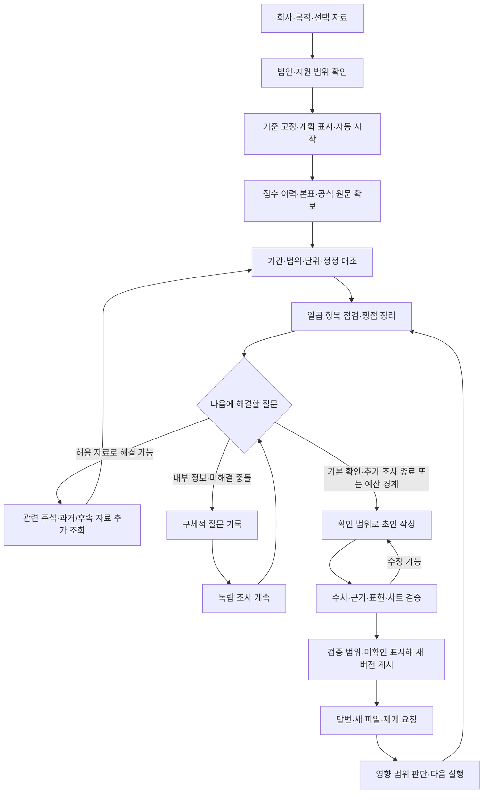

# 조사 실행 흐름·상태·중단·재개

버전 1.0. 상태 이름은 구현을 위한 설계 명칭이다. 반복 상한·모델 선택 계약은 [운영·모델 정책](RUNTIME_AND_MODEL_POLICY.md)을 함께 따른다. 흐름·예외의 제안 중 미결정 사항은 [결정 기록](DECISIONS.md)을 따른다.

## 1. 조사와 실행을 분리한다

`조사`는 회사·목적과 이력을 묶는 단위다. `기준 버전`은 법인·공개 기준일·비교 범위·정책을 고정한다. `실행`은 최초 조사 또는 후속 자료를 처리하는 한 번의 작업이며, `보고서 버전`은 검증 후 게시한 결과다.

한 조사의 이전 보고서를 보존하면서 새 실행이 진행될 수 있다. 대화 ID만으로 다른 회사·기준일의 근거가 섞이지 않게 한다. 스냅샷에 없는 설정 변경을 이미 진행 중인 실행에 몰래 적용하지 않는다.

## 2. 큰 흐름

법인 식별이 해결되지 않으면 해당 법인의 수치를 작성하는 경로에 진입하지 않는다. 허용 범위 밖 조사는 사용자가 범위 확대를 정하기 전 실행하지 않는다.

## 3. 단계별 입력·출력·판정

| 단계 | 입력 | 산출 | 다음 단계 조건 |
| --- | --- | --- | --- |
| 식별 | 회사명·선택 코드 | 법인·후보·지원 범위 | 단일 법인과 범위 확정 |
| 계획 | 기준 버전·일곱 항목·목적 | 기본 작업·자료 필요·예산 배분 | 계획이 사용자에게 표시되고 실행 저장됨 |
| 자료 확보 | 허용 출처·기간·법인 | 원문·접수/정정·본표 응답 | 성공/부재/실패 상태를 모두 기록 |
| 정규화 | 원문·표 구조·원시값 | 범위·기간·단위가 붙은 수치 후보 | 후보가 원문 위치에 연결됨 |
| 대조 | 후보·관련 본표·주석 | 검증 결과·충돌·계산 | 부적합 입력은 보류 |
| 항목 점검 | 합의한 최소 내용·현재 근거 | 확인 범위·미해결 질문·쟁점 | 다음 조회의 필요성을 구체화 |
| 추가 조사 | 쟁점·이미 본 자료·남은 예산 | 새로운 근거 또는 미확인 이유 | 중복 아닌 합의 범위의 조회 |
| 초안 | 주장·계산·확인 범위 | 구조화된 보고서 후보 | 출력에 쓸 근거 집합 고정 |
| 검증·게시 | 보고서 후보·참조 근거 | 새 보고서 버전 또는 수정 항목 | 검증 안 된 주장을 사실로 게시하지 않음 |

## 4. 실행·작업·쟁점 상태를 구분한다

| 객체 | 상태 제안 | 의미 |
| --- | --- | --- |
| 실행 | queued / running / stopping / stopped / finished / finished_with_gaps / interrupted / failed | 작업 대기·진행·명시 중단·확인 범위 종료·장애를 구분 |
| 개별 작업 | pending / running / succeeded / no_data / retryable_error / failed / skipped / awaiting_input | 한 자료를 못 구했다고 실행 전체를 답변 대기로 바꾸지 않음 |
| 쟁점 | open / investigating / needs_user / supported / unresolved / superseded | 설명 상태. supported도 확정 원인이나 위험 해소를 뜻하지 않음 |
| 보고서 후보 | building / checking / published / abandoned | 게시 전 후보와 이미 게시된 결과 분리 |

답변이 필요한 쟁점이 있어도 독립 작업이 남아 있으면 실행은 계속한다. 독립 작업을 마친 뒤 남은 내용과 이유를 표시한 초안을 게시할 수 있다. 질문·답변 대기 시간을 실제 실행 소요와 분리해 집계한다.

## 5. 다음 조사 행동을 고르는 기준과 우선순위

행동 후보는 해결할 질문, 기존 근거, 새로 얻을 정보, 예상 조회, 적용 범위, 중복 여부를 포함한다. 모델이 후보를 제안하더라도 도구 허용·법인/기준일·외부 전송·예산 검사는 실행 코드가 수행한다.

기본 확인 항목이 비어 있는데 한 쟁점만 끝없이 조사하지 않도록 확인 범위를 점검한다. 수치·범위 충돌은 그 수치를 사용하는 주장보다 먼저 해결한다. 해석 후보가 기존 사실과 어긋나면 관련 원문을 확인하고 후보를 수정한다. 근거 없이 위험 등급이나 중요도 점수를 부여하지 않는다.

사용자가 선택한 우선순위는 **자료 충돌·기본 확인 누락 보완 → 대출 목적과 관련된 설명 공백 심화**다. 일곱 항목 전체의 현재 확인 범위를 함께 보며, 한 충돌을 반복 조회하느라 다른 기본 항목을 전혀 확인하지 못하는 상태를 피한다. 다음 행동에는 선행 확인·미해결 이유·남은 예산을 기록한다.

| 판단할 상황 | 다음 행동 | 남길 결과 |
| --- | --- | --- |
| 법인·기간·단위·범위 또는 수치 충돌 | 차이가 난 원문·표 머리글·관련 주석·정정 관계 대조 | 사용 가능한 수치와 보류 수치, 해결 여부·이유 |
| 기본 확인 항목의 공개 근거 부족 | 이미 본 자료를 확인하고 해당 절·주석·허용된 공식 자료 조회 | 확보 내용 또는 실제 조회 시도·접근/자료 한계 |
| 이익·CFO·재고·채권·차입 등의 변화에 설명 공백 | 목적과 관련된 질문을 정하고 관련 주석·과거/후속 자료 확인 | 지지·반대 근거와 해석 수정. 변화 자체로 연체·부실 확정 금지 |
| 공개 자료로 해결 못 하는 내부 정보 | 필요한 자료·대상 기간·이유·영향받는 쟁점을 질문에 연결 | 구체적인 질문, 나머지 독립 조사·초안 계속 |
| 같은 조회만 반복하거나 예산 경계 도달 | 시도·한계 기록 후 다음 가능한 항목 또는 작성 단계 | 미해결·누락을 숨기지 않은 제한 초안 |

이 순서는 조사 우선순위이며 은행의 신용 위험 점수나 대출 승인 기준이 아니다. 특정 증감률을 위험 임계값으로 새로 도입하지 않는다.

반복 조회 식별키의 제안은 출처·법인·접수/파일 버전·절/표·질문·조회 인자다. 같은 자료를 다시 볼 때에는 이전 조회와 달라진 목적 또는 자료 버전을 기록한다. 단순 실패 재시도는 새로운 심화 조사 성과로 세지 않는다.

## 6. 예산·종료 정책

사용자가 선택한 초기 운영값:

| 항목 | 초기 한도 |
| --- | ---: |
| 외부 조회 | 60회 |
| 심화 행동 | 10회 |
| 모델 호출 | 20회 |
| 실제 실행 시간 | 30분 |
| 초안·검증용 시간 확보 | 마지막 5분 |
| 동시 실행 | 1개, 나머지 대기 |

이는 실험용 설정이며 은행·회계 기준이 아니다. 실제 모델·기업·자료로 측정한 성능 보장은 아니다. 변경 설정은 새 실행의 스냅샷으로 남긴다.

정의 제안:

- 외부 조회는 DART·IR·공식 첨부의 실제 네트워크 요청마다 집계하며 실패 재시도·페이지 추가도 포함한다. 캐시를 읽은 횟수는 따로 기록한다.
- 심화 행동은 기본 계획 이후 특정 쟁점을 해결하기 위해 선택한 추가 조사 단위다. 같은 행동의 페이지 분할은 외부 조회에는 반영하지만 심화 성과를 부풀리지 않는다.
- 모델 호출은 계획·분석·작성·검토·구조 수정 호출과 재시도를 포함한다. 모델의 내부 토큰 생성 횟수와 혼동하지 않는다.
- 실행 시간은 실제 작업 시간이다. 대기열·사용자 답변 대기·명시 중단 기간은 구분한다. 네트워크·모델 대기와 오류 재시도 시간은 작업 시간에 포함한다.
- 수집 단계가 종료 여유에 이르면 새 수집을 시작하지 않고 확보 근거로 작성·검증한다. 작성 호출·수정에도 필요한 호출 여유를 따로 남긴다. 외부 요청 최대60초·모델 최대180초이며 남은 실행시간이 우선이다. 총20회 중 마지막4회는 작성·검토·수정용으로 확보한다. 일시 조회 오류 최초 포함3회·초안 수정 최대2회 상한도 적용한다. 마지막5분과 최대 호출시간이 충돌하면 남은 시간 안에서 줄이거나 새 호출을 시작하지 않는다.

자연 종료는 합의한 기본 확인 범위가 기록되고 남은 쟁점의 다음 행동을 수행하거나 보류 이유를 남긴 경우다. 한도 종료는 `finished_with_gaps`와 제한 이유다. 기본 미확인이 남았으면 충족률과 누락을 그대로 표시한다. 종료가 정확성 검증 통과를 뜻하지 않는다.

## 7. 중단·단절·장애 복구

사용자가 조사를 중단하면 현재 실행뿐 아니라 같은 조사의 대기 중 후속 실행도 중지하고 새 도구·모델 작업을 발행하지 않는다. 사용자의 재개 선택 전 답변·파일 수신이나 서버 재시작만으로 대기 작업을 실행하지 않는다. 이미 시작한 호출은 취소 가능하면 취소하고, 늦게 도착한 결과는 중단 전 기준과 실행 토큰을 검사해 잘못 게시하지 않는다. 저장된 근거와 이전 보고서는 유지한다. 중단 응답에서 저장 범위와 미완료 작업을 안내한다.

브라우저/SSE 단절은 실행 중단 명령이 아니다. 재접속은 저장된 이벤트와 현재 스냅샷을 읽으며 조사를 다시 시작하지 않는다.

서버가 꺼져 있는 동안 작업은 진행되지 않는다. **서버 시작 시 예기치 않게 끊긴 조사만 자동 재개**한다. 화면에는 복구 사실·마지막 저장 단계·잔여 한도를 표시한다.

| 복구 대상/상황 | 처리 규칙 |
| --- | --- |
| 직전 서버에서 진행 중이던 실행 | 비정상 중단으로 기록하고 마지막 저장된 작업부터 대기열에 복구 |
| 기존 대기 실행 | 대기 상태·순서를 보존. 한 번에 한 실행만 실제 작업 |
| 명시 중단 요청·stopping/stopped | 서버 장애가 겹쳐도 사용자의 중단 의도를 우선. 자동 실행 금지 |
| 삭제·완료·한도 종료 | 복구 대상에서 제외. 이미 끝난 조사를 새 실행으로 만들지 않음 |
| 인증·설정 등 회복 불가 장애 | 같은 오류를 무한 재시작하지 않고 필요한 설정 안내 |
| 모델 생성 중 장애 | 검증 전 부분 본문을 게시하지 않음. 마지막 게시본 보존 후 잔여 예산으로 해당 작업 재수행 |
| 게시 직후 장애 | 저장된 보고서 버전을 조회해 중복 게시 방지 |

복구에서도 동일 실행·기준 스냅샷·조회/모델/심화 누적 횟수를 유지한다. 이미 소요된 실제 작업 시간을 초기화하지 않고 서버가 꺼져 있던 시간은 별도 기록한다. 작업 시작 시 예산을 먼저 예약·기록하고 완료 후 확정하므로, 전송 여부가 불명확한 요청도 안전하게 소비한 것으로 계산하고 불확실성을 남긴다. 남은 한도가 없으면 새 호출을 하지 않는다.

작업 실행권·세대 토큰으로 이전 작업자의 늦은 결과를 차단한다. 작업과 산출물에 중복 방지 키를 붙이고, 검증된 결과·작업 완료·게시 이벤트를 트랜잭션 경계에서 저장한다. 파일은 임시 저장→무결성 확인→확정 순서로 처리하고, 재시작 때 DB 참조와 파일 상태를 대조한다. 원격 읽기 요청은 장애 직후 다시 호출될 수 있으므로 네트워크의 정확히 한 번 실행을 보장한다고 표현하지 않는다. 결과 중복 제거와 호출 예산 보존을 보장 대상으로 삼는다.

자동 복구는 연속 2회 실패하면 중지한다. 이 값은 설정에서 조정 가능한 초기 실험값이다. 재시작할 때마다 상한을 초기화해 무한 반복하지 않으며, 재시도 한도에 도달하면 보존된 근거와 필요한 조치를 표시한다.

## 8. 후속 답변·범위 변경

일반 메모는 저장만 하고 ‘조사에 반영’을 선택할 때 후속 실행 입력으로 접수한다. 답변·정정 요청·첨부는 연결된 질문·쟁점을 기준으로 처리한다. 원문→수치→계산→주장→차트→보고서 의존 관계를 따라 영향받는 항목을 다시 검증하고 새 보고서를 게시한다. 변경 이유와 전후 차이를 보존한다.

응답이 실행 도중 도착하면 현재 실행의 입력을 고정하고 다음 실행으로 자동 대기시킨다. 수신·대기·적용될 기준과 입력을 표시하며 이미 작성·검증에 쓰인 근거 집합을 바꾸지 않는다. 같은 입력의 재전송은 중복 실행을 만들지 않게 한다. 같은 메시지의 파일은 한 입력으로 접수한다. 같은 기준의 아직 시작하지 않은 후속 입력은 메시지별 이력을 보존해 함께 처리하고, 새 후속 실행에 새 한도를 적용한다. 조사 전체 누적 사용량도 표시한다. 중단은 같은 조사의 대기 작업까지 적용한다.

회사 변경은 새 조사로 만든다. 목적·공개 기준일 변경은 같은 조사의 새 기준 버전과 허용된 자료 집합으로 분리한다. 기존 결과에 조용히 덧붙이지 않고 변경하려는 범위를 표시하며 이전 결과를 보존한다. 이미 기준일 이후에 받은 파일은 수신 시점과 파일의 기준시점을 각각 표시해 과거에 알고 있던 자료처럼 소급하지 않는다.

## 9. 계획 수정은 현재 조사 완료 후 다음 실행에 반영

사용자가 계획을 수정하면 변경 내용을 새 계획 버전으로 저장하고 ‘현재 조사 종료 후 반영’ 상태를 표시한다. 현재 실행의 입력·계획·작성 근거는 바꾸지 않는다. 현재 실행이 끝나면 수정 계획을 적용한 후속 실행을 대기열에서 처리한다. 사용자의 마지막 명시적 선택이므로 이전의 즉시 취소/재시작 의견보다 우선한다.

즉시 멈추고 싶을 때는 중단을 사용한다. 중단은 같은 조사의 대기 후속 실행도 멈추므로, 수정 계획을 등록했더라도 사용자 재개 전 자동 시작하지 않는다. 재개 시 적용할 계획과 기존 저장 지점을 표시한다. 수정이 없는 동일 실행 재개는 기존 한도에서 이어가며, 실제 새 자료/수정 계획으로 시작하는 후속 실행은 새 한도와 누적량을 기록한다.

새 계획에서는 제외한 항목을 새로 조사하지 않는다. 이미 진행했던 원문·검증 결과·보고서는 이력으로 보존한다. 새 계획에 맞는 근거만 다시 활용하고 다른 법인·기준일·범위의 자료를 혼합하지 않는다. 이전 실행의 늦은 응답은 실행/계획 버전을 확인해 새 보고서에 잘못 반영하지 않는다.

현재 범위는 기업별 독립 조사·보고서, 한 번에1개 실행·나머지 대기다. 여러 기업을 하나의 보고서로 합치거나 일괄 선택 제외하는 기능을 새로 추가한 결정은 아니다.
