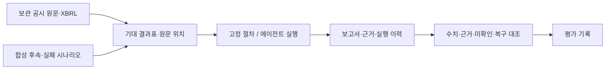
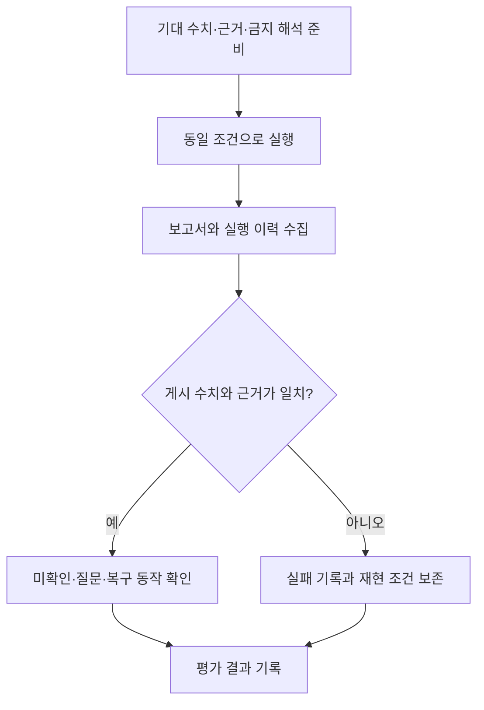

# 금융 사전조사 평가 자료

이 폴더는 보관 공시 사례와 합성 실패 사례를 이용해 수치·근거·미확인·복구 동작을 확인하는 기준 자료입니다. 평가 결과는 실제 금융 전문가 검토나 일반 기업 전체의 정확성을 의미하지 않습니다.

## 아키텍처 구성도

## 워크플로

## 자료

| 파일 | 용도 |
| --- | --- |
| [EXPECTED_RESULTS.md](EXPECTED_RESULTS.md) | 사람이 검토할 행동 기준과 금지 해석 |
| [expected_results.json](expected_results.json) | 수치·원문 위치·산술·오류 상황 |
| [REFERENCE_VERIFICATION.json](REFERENCE_VERIFICATION.json) | 기준 자료를 준비하며 실제 확인한 범위 |
| [source_manifest.json](source_manifest.json) | 고정 원문 해시 목록 |
| [synthetic/](synthetic/README.md) | 실제 기업과 분리한 후속·오류 입력 |

## 평가 원칙

- 정당한 보류와 공개 항목 누락을 구분합니다.
- 문장 일치 대신 수치, 단위, 기간, 범위, 근거 연결을 확인합니다.
- 고정 절차와 에이전트는 같은 자료·모델·예산으로 각각 3회 비교합니다.
- 차이가 없으면 그대로 기록하며 시간 절감이나 정확도 향상을 주장하지 않습니다.
- 기준 자료와 제품 실행 결과를 혼동하지 않습니다.

최근 보관 사례 평가는 확인 114건·보류 16건과 13개 원문 인용을 유지했습니다. 이것은 해당 보관 사례의 개발 검증 결과이며, 전체 조사 수용 또는 일반화된 성능을 입증하지 않습니다.
