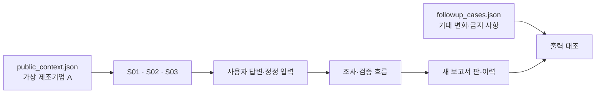
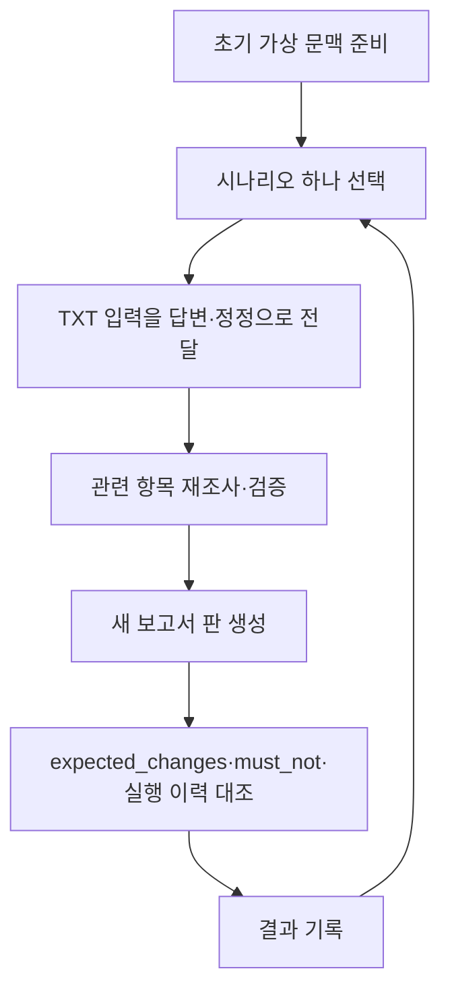

# 합성 후속 입력 평가

이 폴더의 회사명·수치·답변은 모두 직접 만든 시험 자료입니다. 실제 상신브레이크 또는 실제 고객 자료가 아닙니다.

## 아키텍처 구성도

## 워크플로

## 시나리오

| 시나리오 | 입력 | 확인할 동작 |
| --- | --- | --- |
| S01 | [S01_collection.txt](S01_collection.txt) | 실제 회수와 예정 분리, 기존 기준일 잔액 보존 |
| S02 | [S02_loan_purpose.txt](S02_loan_purpose.txt) | 제공 조건으로 표시, 상환 자료 질문 유지 |
| S03 | [S03_conflicting_cfo.txt](S03_conflicting_cfo.txt) | 사용자 설명으로 검증 수치를 덮어쓰지 않음 |

각 시나리오는 같은 초기 문맥에서 독립적으로 시작합니다. 앞 시나리오의 답변을 다음 시나리오에 누적하지 않습니다. 가상 입력이 원문 대조 또는 실제 기업 내부 정보 확인을 뜻하지 않도록 결과에 명확히 표시합니다.
